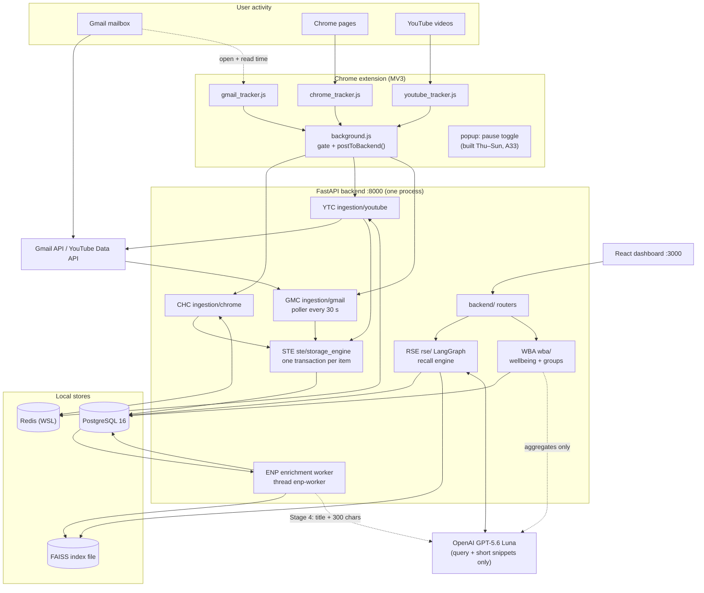
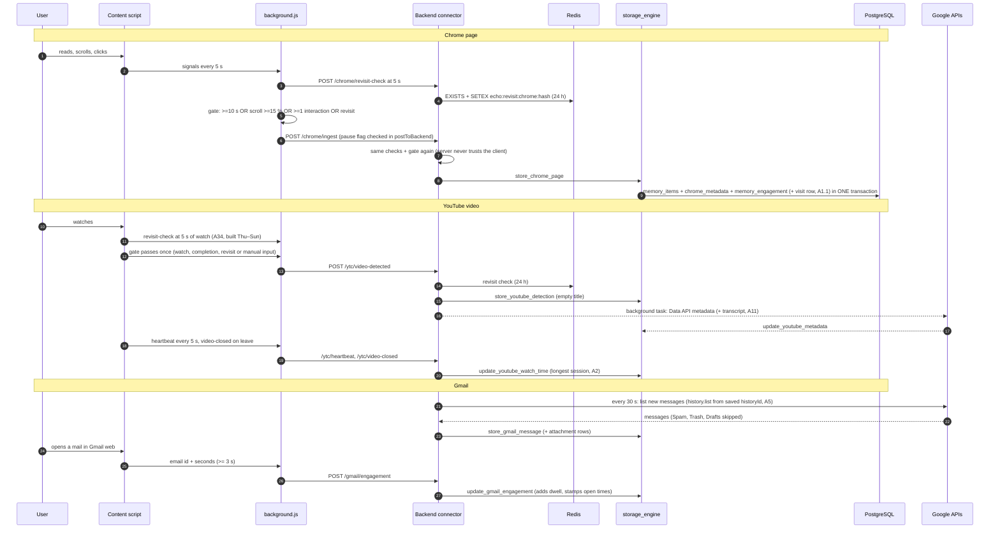
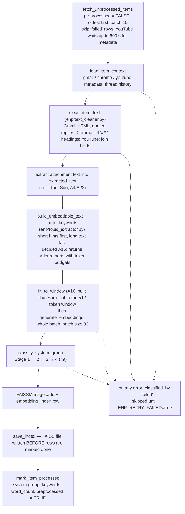
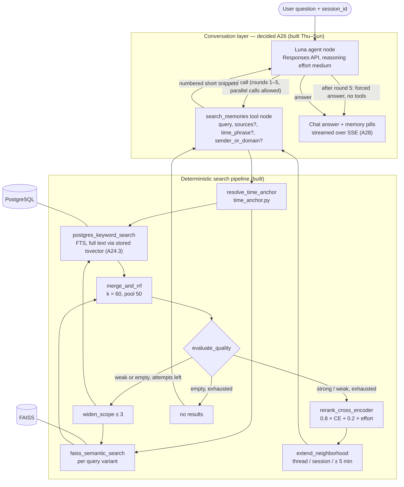
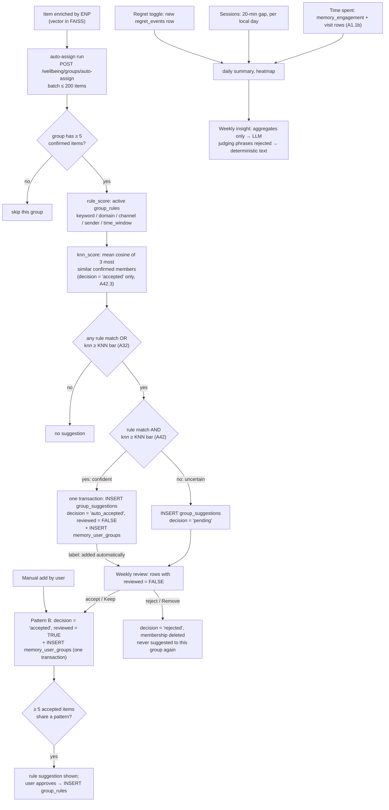
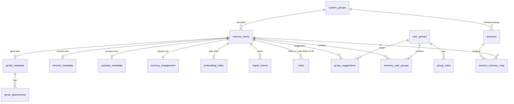

# E.C.H.O — System Design (Architecture and Database)

**Efficient Contextualized History Orchestrator** — a local-first, single-user personal memory system.

| Field | Value |
|---|---|
| Document | Complete system design: architecture (Part I) and database design (Part II) |
| Version | 3.0 |
| As of | Wed 21 Oct 2026 |
| Replaces | `Echo_Architecture_Design.md` (v2.1, Mar 2026) and `Echo_DB_Design.md` (v5.0, Mar 2026). Both stay recoverable: `git checkout HEAD -- docs/Timeless_docs/<file>` |
| Owner | Mohammed Shehzaad Khan. Owner-maintained: change this file only on his request |
| Decision record | `docs/review/ste_open_items.md` (ids A1–A45, B, C, D, E); measured briefs for A16/A40/A42/A43 are folded into their entries in `ste_open_items.md` |
| Schema source | `scripts/setup_db.py` |
| Build window | Thu 22 – Sun 25 Oct 2026. Final review: Wed 28 Oct 2026 |

## How to read this document

Every statement carries one of three statuses.

- **No label** — built. It is in the code on branch `phase3-review2` on 21 Oct 2026, checked against the file named.
- **(built Thu–Sun)** — decided, not yet in the code. The code changes during the build window. Where code and a decision differ, this document describes the decision and names the code value it replaces.
- **Pending decision** box — open. Never treat it as decided. (None remain: every A-item was decided by 21 Oct 2026.)

Numbering: §1–§21 keep the section numbers of architecture v2.1, because code comments and the decision record cite them
(for example "§6.2", "§7.3", "§15.3"). §22–§24 are new. Part II keeps the table numbers 1–16 of DB design v5
("DB design Table 14"), and adds Table 17. Appendix A lists every change from the earlier design.

Open items at a glance (details in §24): no design decision is open. A1–A45 and E1 are decided; the last four
(A16, A40, A42, A43) were closed on 21 Oct 2026. Still open are build-or-drop items D3 and D5 (D4 was built on 23 Oct 2026), not design questions.

---

# Part I — Architecture

## 1. What is Echo?

### 1.1 The Problem

A student gets an interview email, reads articles about operating systems, and watches YouTube tutorials on the same
topic. A week later the material is spread over Gmail, Chrome history and YouTube. No tool searches all three at once,
and none knows that the articles came *after* the email.

### 1.2 What Echo Does

- **Captures** emails (Gmail API), web pages (Chrome extension) and YouTube videos (extension + YouTube Data API) on the user's laptop.
- **Filters by intent.** Pages and videos are kept only when the user paid attention to them (§6.2, §7.3). Every email is kept.
- **Unifies** everything into one table (`memory_items`), one vector index (FAISS) and one keyword index (PostgreSQL full-text search).
- **Recalls** through a chat. The LLM (GPT-5.6 Luna) calls one read-only search tool; the search itself is deterministic Python (§10).
- **Reflects** on time use without judging: time per category, sessions, user-declared regret, weekly descriptive insights (§11).

### 1.3 What Makes Echo Different

| Principle | What it means |
|---|---|
| Local-first | PostgreSQL, Redis and FAISS run on the laptop (A31). What leaves the machine is listed in §13.2. |
| Intent-aware | A page left after 3 s is discarded; a page read for 10 s or scrolled 15 % is kept (§6.2). |
| Cross-source search | One query returns emails, pages and videos in one ranked list (keyword + semantic, fused by rank). |
| Deterministic search | The LLM chooses *what* to search for; *how* the search runs is fixed Python: FTS + FAISS → RRF → cross-encoder. |
| Conversational | Follow-up questions use the earlier turns of the same chat session (§10.7). |
| Non-judgmental wellbeing | Descriptive numbers only. No scores, no blocking, no "wasted time" wording. Regret is declared by the user. |

### 1.4 What Echo is NOT

- Not a productivity tracker or scoring system.
- Not a cloud service. Personal data is stored only on the laptop.
- Not a content blocker or screen-time limiter.
- Not a surveillance tool: incognito is never tracked (`"incognito": "not_allowed"` in `extension/manifest.json`), typed text is never captured.
- Not a mobile app: capture covers desktop Chrome (and Chromium browsers that load the extension) plus the Gmail API.
- Not an agent that acts. The LLM can only call a read-only search tool, at most 5 rounds per question (A26).

## 2. Core Design Principles

These six principles hold for every module.

### 2.1 Intent-First, Not Surveillance

Save only what the user paid attention to. A misclick closed within 5 s is never stored, and leaves no revisit flag (A10).
Gmail is the exception: every received or sent mail is stored, because mail arrives without the user choosing it and
"did I get a mail about X?" must work for unread mail too (§5.1).

### 2.2 Local-First (Privacy by Design)

All personal data lives in PostgreSQL, FAISS and Redis on the laptop (A31, decided 2026-10-21; Neon and Upstash were
the development setup and are dropped). The data that leaves the machine is fixed and small: the Google API calls that
fetch the user's own data, and the LLM calls listed in §13.2. Privacy statement used for the panel (A31.5):
"storage and processing are local; only the query and short snippets go to the LLM, never full mails, pages or
transcripts; Gmail/YouTube APIs fetch the user's own data."

### 2.3 Progressive Enrichment

Capture writes a minimal row at once, in one transaction, with `preprocessed = FALSE`. The enrichment worker (ENP, §8)
later cleans the text, builds the embedding, classifies the system group and indexes the item. Capture never waits for
ENP; if ENP is stopped, capture continues.

### 2.4 Deterministic Search, LLM-Directed Recall

The LLM never touches the database. It decides the search terms, sources and time phrase, and writes the answer.
Search, fusion, re-ranking, time-anchor resolution and neighbourhood context are deterministic Python. LLM calls per
question: usually 2, at most 6 (A26, decided 2026-10-18; enforced in code, not in the prompt).

### 2.5 Single-User Installation

One user, one laptop. No users table, no multi-tenant isolation, no cloud sync. (A multi-user auth layer existed briefly
and was deleted on 2026-09-01; nothing depended on it.)

### 2.6 Non-Judgmental Wellbeing

Echo shows descriptive patterns. It never scores, predicts addiction, judges or blocks. Regret is declared by the user.
LLM-written insights receive aggregated numbers only, and replies with judging phrases are rejected (§11.7).

## 3. System Architecture Overview

### 3.1 The Big Picture

Three sources feed three connectors. One storage engine writes PostgreSQL. A background worker enriches and indexes.
The recall engine and the wellbeing module read the stores and serve the React dashboard.

### 3.2 Three-Layer Storage

| Store | Technology | What it holds | Rebuildable? |
|---|---|---|---|
| PostgreSQL | PostgreSQL 16, local Windows service (A31.6) | Every item, its metadata, engagement, visits, groups, rules, suggestions, regret events, sessions, chat history | No — the only permanent truth |
| FAISS | `faiss-cpu`, `IndexFlatL2`, 384-d, file `data_faiss/echo_faiss.index` + `.meta.json` | One vector per item | Yes — reset `preprocessed = FALSE`, ENP re-embeds |
| Redis | Redis in WSL Ubuntu (A31.6) | Revisit flags (24 h), attachment text cache (1 h), capture settings, reminder rate limits, Gmail `historyId` (A5) | Mostly. Capture settings and the reminder disable flag are persistent keys (§4.3) |

### 3.3 Data Flow Example

Scenario: the user gets an interview email, studies OS scheduling, and asks Echo the next day.

1. The mail arrives. Within 30 s the Gmail poller stores it (`gmail_metadata`, provisional group `personal`, `preprocessed = FALSE`).
2. ENP (every 10 s) cleans the body, builds the embeddable text, embeds it, classifies it (Stage 1: `CATEGORY_UPDATES` → `misc`, or a work sender domain → `work`), and indexes it.
3. The user opens the mail in Gmail web. `gmail_tracker.js` reports the email id and reading seconds (≥ 3 s) to `POST /gmail/engagement`.
4. The user reads a GeeksforGeeks article for 3 minutes and scrolls 60 %. The extension's gate passes (≥ 10 s), the server repeats the gate and stores the page.
5. The user watches "OS Scheduling Algorithms" for 5 minutes. The extension's gate passes at 20 s of watch time; the server stores the row and fetches title, channel and category from the Data API.
6. Next day: "OS stuff I read after the interview email". Luna calls `search_memories(query="operating systems scheduling", time_phrase="after the interview email")` (built Thu–Sun, A26). The tool resolves the anchor email deterministically, keeps only items after it, runs keyword + semantic search, fuses by RRF, re-ranks with the cross-encoder, and returns numbered snippets. Luna answers in chat style with memory pills (A27).

### 3.4 Capture Flow (all three sources)

## 4. Storage Layer — Detail

### 4.1 PostgreSQL — Main Database

- **Role.** The only permanent store. FAISS and most Redis data can be rebuilt from it; it cannot be rebuilt from them.
- **Where.** Local PostgreSQL 16, database `echo_db`, role `echo` (A31.1). The Neon data of the test account was moved over
  once on 2026-10-24 with `pg_dump -Fc` (direct Neon host, not the pooler) → `pg_restore` (A31.2). Neon was PostgreSQL 16.15,
  so the local 16 client tools worked. All 16 tables matched Neon on row counts and row hashes. Neon stays as a frozen fallback.
- **Time.** Every timestamp is naive UTC. Each connection is forced to UTC (built 2026-10-24, A31.4: SQLAlchemy engine in
  `ste/postgresql_manager.py`, psycopg2 pool in `rse/search_coordinator.py`, ENP's connection), because a local
  server would otherwise take the machine's zone (IST) and shift every `NOW()` by 5:30. As a second layer the database itself is
  set with `ALTER DATABASE ... SET timezone TO 'UTC'` (done by `scripts/setup_db.py`); `scripts/setup_db.py` and
  `scripts/enp_status.py` open plain connections and rely on it. The UI shows IST.
  One exception: `regret_events.marked_at` is local time (C22).
- **Access styles (do not mix inside one file).**
  - SQLAlchemy with `:name` parameters — `ste/postgresql_manager.py`; used by `ste/`, `wba/`, `backend/items.py`, the Gmail
    connector. Pool 5 + overflow 10, recycle 240 s, slow-query warning at 1.0 s.
  - psycopg2 with `%s` parameters — `rse/search_coordinator.py` (pool 1–10, idle ping after 60 s) and `rse/conversation_memory.py`.
  - `enp/enrichment_pipeline.py` opens one psycopg2 connection per batch.
- **Schema.** 17 tables since 2026-10-24: the schema batch added Table 17 (`visits`), `memory_items.search_vector` and
  `gmail_attachments.extracted_text`, and dropped `memory_items.classification_confidence` (Part II, D9). The 16-table lock is
  lifted (A31.3): every schema change must belong to a decided item and is written twice — in `scripts/setup_db.py`
  and as ALTER SQL on the restored database — before the full re-embedding. The code that fills and reads them was wired on
  2026-10-24: visit writes (`ste/storage_engine.py`), ENP writing `search_vector` and `extracted_text`, keyword search and the
  time filters reading them, wellbeing summing visits by day. Still open: merging attachment text into the embedded text (A16).

### 4.2 FAISS — Semantic Search Index

- **Index.** `IndexFlatL2`, 384 dimensions, mirrored by a numpy vector cache (`ste/faiss_manager.py`). Files live in
  `data_faiss/` (git-ignored, C16): `echo_faiss.index`, `echo_faiss.index.meta.json`, and `centroids.npz` (§9.3).
- **Model (A40.1, decided 2026-10-21, built Thu–Sun).** `Snowflake/snowflake-arctic-embed-xs`: 384-d, 512-token window
  (`max_seq_length` 512), CLS pooling, ends in a Normalize layer, Apache-2.0. It is MiniLM-L6 retrained for retrieval.
  `ste/faiss_manager.py` `EMBEDDING_VERSION = "snowflake-arctic-embed-xs-v1"`; `VECTOR_DIMENSION` stays 384, so the FAISS
  dimension does not change. The model is loaded by its repo id. Code today: the earlier model `all-MiniLM-L6-v2`
  (`enp/embedding_generator.py` `MODEL_NAME`, `EMBEDDING_VERSION = "all-MiniLM-L6-v2-v1"`; `max_seq_length` 256, trained on
  128 tokens). The switch lands before Thursday's full re-embed (B5); after it, a model switch costs another full re-embed.
- **Query vs document path.** Questions get the model's query prefix, read from its shipped config (`model.prompts["query"]`
  = "Represent this sentence for searching relevant passages: "), never hard-coded: a new `generate_query_embeddings(texts)`
  used by `rse/search_coordinator.py` and `rse/time_anchor.py`. Items, centroid seeds and group KNN use the document path
  (no prefix).
- **Why arctic-xs (measured on his laptop, 39 test questions).** Right item first 37/39 (MiniLM 31, bge-small 36,
  granite-r2 at 1,024 tokens 35); in the top 5, 39/39. About 221 ms per item at 512 tokens (on battery, shared CPU). Fallback
  if Thursday's data shows long pages found by keyword but missed by meaning: `granite-embedding-small-english-r2` at 1,024
  tokens (same 384-d, ~9× the embed time, its vectors must be normalised in code).
- **Distance.** The stored vectors are unit length (measured 2026-10-17 on all 110 saved vectors, C14), so L2 order
  equals cosine order. arctic-xs also ends in a Normalize layer, so this holds after the switch. Every cosine threshold
  (quality gate, Stage-3 centroids, KNN groups) is still computed as true cosine through `faiss_manager.cosine()` /
  `search_all()`. arctic-xs scores sit higher than MiniLM's (unrelated pairs ~0.40 instead of ~0.06), so every cutoff gets
  a new start value, tuned Thursday (§22).
- **Thread safety.** Every `FAISSManager` method holds an RLock; saves are atomic (temp file + rename); a failed load is
  not cached as an empty index; load raises if only one of index/meta exists.
- **Audit trail.** Each vector has an `embedding_index` row with the exact `embeddable_text` that produced it (Table 11).
- **Rebuild.** No rebuild script exists any more (deleted 2026-10-19). A rebuild is: `UPDATE memory_items SET preprocessed = FALSE`,
  ENP re-embeds every row. On Thursday the restored data is fully re-embedded into a fresh index (A31.2, B5); the old index is discarded.
- **Delete.** `FAISSManager` has no remove method today. The retention job (A37) needs one (built Thu–Sun).

Cross-encoder (A40.2, decided 2026-10-21): stays `cross-encoder/ms-marco-MiniLM-L-6-v2`. L-12 found the same items at 2× the
time; `bge-reranker-base` was worse here and 12× slower. What it reads changes (A40.3, §10.3).

### 4.3 Redis — Signals and Small State

Redis runs locally in WSL Ubuntu (A31.6: `sudo apt install redis-server`; start with
`wsl -d Ubuntu -u root service redis-server start`). WSL stops when no process runs in it, and Redis stops with it; keep it up
with `wsl -d Ubuntu -u root -- sleep infinity`. `REDIS_URL=redis://127.0.0.1:6379/0`. Socket timeout 5 s (`ste/redis_manager.py`). Every key is under `echo:`.

| Key | Written by | TTL | Purpose |
|---|---|---|---|
| `echo:revisit:chrome:<hash>` | `ingestion/chrome/revisit_tracker.py` | 24 h (`REVISIT_TTL_SECONDS = 86400`) | Chrome revisit flag (sliding 24 h, not "earlier today") |
| `echo:revisit:youtube:<hash>` | `ingestion/youtube/youtube_connector.py` | 24 h | YouTube revisit flag |
| `echo:attachment:<memory_id>:<attachment_id>` | `enp/attachment_processor.py` | 1 h (`ATTACHMENT_CACHE_TTL_SECONDS = 3600`) | Tier-2 attachment text. Once A4 stores text in PostgreSQL, the answer path no longer needs it; keep or drop (TBD at build) |
| `echo:settings:capture` | `ste/settings_store.py` | none | Source toggles, excluded domains, excluded senders; retention window added (built Thu–Sun, A37) |
| `echo:regret:reminders:disabled` | `wba/regret_system.py` | none | User disabled regret reminders |
| `echo:regret:reminder:cooldown` | `wba/regret_system.py` | 2 h | Gap between reminders |
| `echo:regret:reminder:type:<source>:<day>`, `echo:regret:reminder:total:<day>` | `wba/regret_system.py` | 24 h | Daily reminder counts |
| `echo:gmail:history_id` | Gmail connector | none | Last Gmail `historyId` for incremental polling (built Thu–Sun, A5) |

Redis is optional at startup (`backend/main.py` `_connect_redis`). When it is down: a revisit check answers "first visit",
settings fall back to defaults, reminders turn off, the attachment cache misses. Nothing raises to the user.

## 5. Gmail Module (GMC)

### 5.1 What Gets Captured

Every message in the mailbox, received and sent, with no intent gate. Excluded: Spam and Trash (Gmail API default
`includeSpamTrash = false`; A38 — "Gmail's spam filter is our spam model"), drafts (`DRAFT` label), and senders on the
user's exclusion list. Promotions, Social and Updates mail is captured (A38, his choice).
Unread mail is searchable but never counts as wellbeing time (§11.2).

### 5.2 Ingestion Flow — Step by Step

**Step 1 — poll (every 30 s, `ingestion/gmail/config.py` `CHECK_INTERVAL`).**
Built 2026-10-24 (A5, A38): incremental polling. `fetch_and_store_new_emails` asks `history.list` (`historyTypes=messageAdded`,
500 per page) for the messages added since the `historyId` saved in Redis (`echo:gmail:history_id`); with nothing new that is one
cheap call. A missing key (first start, Redis lost or down) or a 404 (id too old) makes it run one full listing instead (100 per
page, ids checked against the DB in one batched query per page). The full listing reads the mailbox's current `historyId` first,
so mail that arrives during the listing falls into the next history window. The saved id moves forward only when every new email
of the poll is in the database (checked with a query, because `store_in_postgresql` returns False both for a duplicate and for an
error); the dedup constraint makes any repeat harmless. Messages whose `labelIds` contain `SPAM` or `TRASH` are dropped from the
history ids, and again after `messages.get` (mail trashed after it arrived), because `history.list` has no `includeSpamTrash`
switch. Emails skipped for an excluded sender are re-checked each poll, so un-excluding captures them (not after a backend
restart: older excluded mail is no longer re-listed).
Why not push (Pub/Sub webhook): it needs a GCP topic and a public tunnel, and puts a cloud piece into the local privacy story.

**Step 2 — parse (`ingestion/gmail/gmail_api.py`).** Received time = Gmail `internalDate` (the `Date` header is the
fallback). Recipients split into one array element per address. `is_sent = "SENT" in labelIds`. Labels stored for Stage 1.
Body: HTML becomes text with line breaks; script, style, head, comments and tracking pixels removed; entities and
zero-width characters cleaned; charset honoured. Decided (built Thu–Sun, A6): drop elements hidden by inline style
(`display:none`, `visibility:hidden`, `max-height:0`, `font-size:0`, `opacity:0`), and join all body text parts in order
(inside `multipart/alternative` pick one: plain, else HTML; parts with a filename stay attachments).

**Step 3 — store (`ste/storage_engine.store_gmail_message`), one transaction:** `memory_items` (provisional group
`personal`, `preprocessed = FALSE`), `gmail_metadata`, `memory_engagement` (open times NULL), and one `gmail_attachments`
row per attachment. `UNIQUE(source_type, source_id)` makes a re-poll a no-op.

**Step 4 — enrich (ENP, §8).** Quoted replies removed, keywords, thread keywords, embedding, system group.

**Step 5 — engagement (kept, A41).** `extension/content/gmail_tracker.js` measures reading time on the open mail
(idle after 30 s without input; an open under 3 s is not a visit; 60 s of uninterrupted focus is credited) and sends
only the email id and seconds. `POST /gmail/engagement` → `update_gmail_engagement` adds the seconds to
`dwell_time_seconds`, sets `first_opened_at` once and `last_accessed_at` every time. It feeds wellbeing time and the effort
score; it never filters retrieval (Gmail is filtered by arrival date, A1.1).

### 5.3 Thread Context Enrichment

A reply such as "Re: Thanks, looks good" has no topic words of its own. ENP adds up to 4 keywords from earlier messages
of the same `thread_id` (`enp/topic_extractor.py` `THREAD_KEYWORD_LIMIT = 4`) to the reply's embeddable text, so it is
found by the thread's topic. Known issue (C11): the thread lookup should require `preprocessed = TRUE`, because a failed
earlier message carries error text in `auto_keywords`.

### 5.4 Attachment Handling

| | Today (built) | Decided (built Thu–Sun) |
|---|---|---|
| At ingestion | One `gmail_attachments` row per attachment; `lightweight_extract = "filename \| mime \| size"` (no file content, keeps the hot path fast) | Same row. Inline parts (Content-Disposition inline / Content-ID) and images under ~10 KB are skipped (A22.2; exact size TBD at build) |
| Text extraction | Only at query time (Tier 2), for a top-3 Gmail result when the query asks for file content | In the ENP worker for every attachment not read yet (built 2026-10-24); text stored in `gmail_attachments.extracted_text` (A4), cut at 200,000 characters (`MAX_EXTRACTED_TEXT_CHARS`, so the stored vector stays under PostgreSQL's 1 MB limit); types with no extractor are not downloaded; a failed download leaves it NULL and the mail is still enriched; `is_processed = TRUE` once merged |
| Types | PDF (pypdf → pdfplumber), DOCX (incl. tables, header/footer), TXT/MD/CSV/TSV/LOG/JSON/XML/ICS, HTML. Built 2026-10-24 (D2, standard library only, no new dependency): XLSX, PPTX (slides + notes), EML. Images only if Tesseract is installed (it is not) | OCR for images and scanned PDFs (Tesseract + `pytesseract`). Skipped: `.doc`/`.xls`/`.ppt`, RTF, ODT, ZIP, HEIC (A22.1; RTF is refused explicitly so `text/rtf` is not read as plain text). A22 named `openpyxl` and `python-pptx` for XLSX/PPTX; zip-and-regex readers (size-capped, no XML parser) replaced the libraries |
| Embedding | Not embedded at all (C15) | Token budget (A16, replaces A4's 800-char split): body up to 300 tokens, then attachments fill the rest of the 512-token window, each attachment's start in turn (§8.2) |
| Keyword search | Not searchable | Full extracted text goes into the stored tsvector (A4, A24.3) |
| Sent to the LLM | Up to 6,000 chars per attachment, 12,000 total (`MAX_CHARS_PER_ATTACHMENT`, `MAX_CHARS_TOTAL`) | Only the top 3 passages that match the question, ~1,500 chars total, read from the stored text; no Gmail download at query time (A23, A4) |
| Same filename twice | First one is always downloaded | Match on filename + `file_size` (A22.3, built 2026-10-24; unknown size or no size match falls back to the first same-named part) |

Binary files are never stored. Audio and video attachments are out of scope.

### 5.5 Key Files (GMC)

`ingestion/gmail/gmail_api.py` (OAuth, listing, parsing), `ingestion/gmail/router.py` (`/gmail/health`, `/gmail/poll`,
`/gmail/engagement`, `poll_forever`), `ingestion/gmail/database.py`, `ingestion/gmail/config.py`,
`extension/content/gmail_tracker.js`, `enp/attachment_processor.py`.
OAuth token: plain `token_gmail.json` (A35, built 2026-10-24; it was the Fernet file `token_gmail.enc`, which is now ignored, so the first start signs in again; §13.1). Scope `gmail.readonly`. The browser sign-in runs once at startup on a daemon thread (`sign_in_gmail`, C28); the poller only uses the token and skips while signed out.

## 6. Chrome Browsing Module (CHC)

### 6.1 Architecture — Chrome Extension, Not History API

A Manifest V3 extension (`extension/`), not `chrome.history`: the history API gives visit times only, with no foreground
time, scroll depth or interactions. Permissions: `tabs`, `storage`, `idle`; host permission `http://localhost:8000/*`;
`incognito: not_allowed`. `chrome_tracker.js` runs on every URL except YouTube; `gmail_tracker.js` on `mail.google.com`;
`youtube_tracker.js` on `www.youtube.com`. Every network call goes through `postToBackend()` in `background.js`, which
reads the pause flag `echo_tracking_paused` from `chrome.storage.local` on every call.

### 6.2 Two-Phase Intent Gate

The gate runs in the extension (`extension/background.js`) and again on the server (`ingestion/chrome/intent_filter.py`).
The two copies must hold the same numbers.

**Phase 1 — exposure.** The page is in the foreground for ≥ 5 s. Below that, nothing is written anywhere — no row and no
revisit flag (A10: the flag is written only after 5 s; the v2.1 example "4 s visit → saved on revisit" was wrong).

**Phase 2 — intent.** At least one of:

| Signal | Threshold | Code today |
|---|---|---|
| Foreground active time | ≥ 10 s | `PHASE2_MIN_SECONDS` / `PHASE2_MIN_FOREGROUND = 10` |
| Scroll depth | ≥ 15 % of page height | 0.25 → **0.15** (built Thu–Sun, A39) |
| Interactions | ≥ 1 click or text selection; clicks on links (`a[href]`) do not count | count includes link clicks → excluded (built Thu–Sun, A39 part 2) |
| Revisit | Same canonical URL seen ≥ 5 s in the last 24 h (Redis) | `/chrome/revisit-check` at 5 s |

Examples with the decided values:

| Scenario | Phase 1 | Phase 2 | Result |
|---|---|---|---|
| Open, close after 3 s | fail | — | discarded, no revisit flag |
| Open 6 s, no scroll, no interaction | pass (flag written) | fail | discarded |
| Open 8 s, scroll 20 % | pass | pass (scroll ≥ 15 %) | saved |
| Open 7 s, click a headline link, leave | pass | fail (link clicks don't count) | discarded |
| 6 s now, return 6 s three hours later | pass both times | second visit: revisit | saved on the second visit |
| Read 12 s, no scroll | pass | pass (≥ 10 s) | saved |

Server order of checks (`chrome_connector.ingest_chrome_page`), cheapest first: capture enabled → domain not excluded →
not a skipped path → not a sensitive page → Phase 1 (record revisit flag) → app page handling (§6.5) → Phase 2.
Every discard is logged with the domain only (a discarded URL can carry `?code=` or `?token=`).

### 6.3 Time Tracking — Strict Rules

A second counts only when the tab is the active tab **and** the browser window has focus **and** the user has not been
idle for 30 s (`chrome.idle.setDetectionInterval(30)`). Content scripts send signals every 5 s.

Known gap (C5): the page is sent once, when its gate passes; time after that is never sent, so a 20-minute read is
stored as roughly the gate time. Planned fix: on tab close send the extra dwell since the first send
(`ste/storage_engine` already adds dwell on conflict). Per-visit dwell is stored in Table 17 (built Thu–Sun, A1.1b).

### 6.4 Revisit Handling

A return to a stored canonical URL never creates a second item. The upsert (`ste/storage_engine._upsert_memory_item`,
`_store_source_metadata`, `_store_memory_engagement`) does: `dwell_time_seconds` += new dwell; `last_accessed_at` = now;
`scroll_depth` = max(old, new); `interaction_count` = max(old, new); `revisit_count` += the count the extension sends;
`play_sessions_count` += 1; title and `raw_text` replaced only when the new value is non-empty.
Decided (built Thu–Sun): each gated visit also writes one visit row (Table 17, A1.1); and when a revisit brings new page text
(`raw_text IS DISTINCT FROM` the stored text), the row gets `preprocessed = FALSE` so ENP re-embeds and re-classifies it (A3).
Side effect accepted: pages that change on every load are re-embedded on every revisit.

(Some code comments cite "§6.4" for content extraction and headings; that topic is §6.6.)

### 6.5 Application Pages

Deviation, decided 2026-10-21 (A8.1): pages of work apps are stored as **per-page memory items with their tab title and
`raw_text = NULL`**, not "session duration only" as v2.1 said. Their text is never captured; the title is embedded and
searchable and can reach the LLM as a snippet.

- **App domain list (A9.4): 7 domains**, whole domain and subdomains: `slack.com`, `atlassian.net`, `notion.so`, `figma.com`,
  `linear.app`, `trello.com`, `asana.com`. Code today has 11 (`intent_filter.APPLICATION_DOMAINS`), including
  `mail.google.com`, `app.slack.com`, `confluence.atlassian.net`, `jira.com` — removed (built Thu–Sun).
- **Public sections stay normal pages (A9.3)**, text captured: a first path piece in a fixed list of 38 (help, support, guide,
  guides, docs, learn, resources, articles, tutorials, academy, templates; features, pricing, plans, product, solutions,
  enterprise, integrations, apps, customers, download, about, security; blog, news, press, changelog, events, webinars,
  community, forum, developers; careers, jobs, legal, privacy, terms, api), or a first hostname label in a list of 10
  (help, support, blog, docs, developers, developer, community, academy, learn, status; not on `atlassian.net`).
  Unknown paths stay private (fails closed). Known gap: language prefixes (`/intl/en-in/help`) stay text-less.
- **Gmail web is skipped entirely** in Chrome capture (A9.1): `mail.google.com` never becomes a Chrome row; mail comes from the API.
- **Echo's own pages** (`localhost:3000`, `localhost:8000/docs`) are not skipped (A9.2). Zero-code fallback: add `localhost` to excluded domains.
- **Server minimum (A8.2, built Thu–Sun):** the server discards an app page with `dwell_seconds < 5` and `interaction_count == 0`.
  Today the extension sends after 5 s or 1 interaction (`APP_PAGE_MIN_SECONDS = 5`) and the server accepts any app page.
- **One copy of the lists (A9.5, built Thu–Sun):** new `GET /chrome/rules` returns app domains, public paths and subdomains,
  sensitive words and secret query keys. `background.js` fetches it at startup into `chrome.storage`; `chrome_tracker.js`
  reads it there. Until the rules load, no page text is extracted (fail closed); there is no built-in fallback list.
  Today the lists exist in three copies that must match (`chrome_connector.py`/`intent_filter.py`, `background.js`, `chrome_tracker.js`).

### 6.6 Content Extraction

Main-content extraction happens **in the extension**, not in ENP. `chrome_tracker.js` takes the visible text of
`<article>`, else `<main>`, else `<body>`, whitespace collapsed, kept only between 200 and 12,000 characters
(`MIN_CONTENT_CHARS`, `MAX_CONTENT_CHARS`). No text is sent for app pages, sensitive pages, or pages with a private form.
ENP's Readability branch never runs on Chrome rows (A13 finding).

Decided (built Thu–Sun):
- **Headings (A13):** the extension also sends the visible h1–h3 texts of the chosen node (about 10 headings / 200 chars at most)
  as the first lines of the text, each prefixed `## `; ENP `clean_chrome_text` lifts them into `headings`, which feed the embedding.
  Old pages keep no headings (their text is already flattened).
- **Private form check (A7.4):** a visible password box → private; 3 or more visible email/tel boxes in one `<form>` → private;
  `type=number` ignored; the 5-field rule (`PRIVATE_FORM_FIELD_COUNT = 5`) counts visible fields only. Today any
  email/tel/number input counts, so newsletter boxes block the text of most blogs.

### 6.7 Privacy Rules

- Incognito: the extension does not run there (`incognito: not_allowed`).
- Typed text, form inputs, passwords: never read.
- Sensitive pages (never stored). Today: 14 words matched as whole path segments, segment prefixes, or query keys
  (`chrome_connector.SENSITIVE_PATH_TERMS`). Decided (built Thu–Sun):
  - **Whole-token matching (A7.1):** host and path split on `/ - _ .`; each segment is also checked with separators removed (`sign-in` → `signin`).
  - **38 words, fixed (A7.2):** account, accounts, auth, billing, callback, checkout, login, logout, oauth, password, payment, payments,
    profile, settings, signin, signup; reset, verify, verification, otp, 2fa, mfa, sso, recover, recovery; bank, banking, netbanking,
    wallet, upi, invoice, invoices, orders, cart; admin, dashboard, inbox, messages. Left out on purpose because they are common in
    article URLs: health, medical, insurance, tax, order, token, session. Health, bank and tax portals go in excluded domains.
  - **Secret query keys stripped on the server (A7.3)** from `url` and `canonical_url` before storing: token, access_token, id_token,
    code, state, key, sig, signature, session, sid, pwd, otp, rlkey. The sensitive-page check runs **before** stripping, so the
    query-key test (`?password=`) still sees them. Accepted: two URLs that differ only in such a key become one item.
- Tracking parameters dropped from the canonical URL: `utm_source`, `utm_medium`, `utm_campaign`, `utm_term`, `utm_content`,
  `fbclid`, `gclid`, `ref`, `_hsenc`, `mc_eid`, `yclid`, and the `#fragment`.
- GitHub issue/PR pages are meant to be skipped, but the pattern `github.com/issues` never matches a real repo URL
  (`github.com/owner/repo/issues/12`) — known, recorded under A7.
- User controls: excluded domains (exact host or subdomain), per-source capture toggles, pause toggle in the popup (A33, built Thu–Sun).

### 6.8 Key Files (CHC)

`extension/manifest.json`, `extension/background.js` (gate, relay, pause, revisit check), `extension/content/chrome_tracker.js`
(signals, text, headings), `ingestion/chrome/chrome_connector.py` (`/chrome/ingest`, `/chrome/revisit-check`, `/chrome/rules` built Thu–Sun),
`ingestion/chrome/intent_filter.py`, `ingestion/chrome/revisit_tracker.py`.

## 7. YouTube Module (YTC)

### 7.1 Platform Scope and Honest Limits

- Works: videos and Shorts watched on `www.youtube.com` in desktop Chrome with the extension.
- Not covered: the YouTube mobile app, background play, picture-in-picture, history before the extension was installed
  (a Takeout import is a stretch item, E2, from Mon 26 Oct, not in the demo unless finished).
- YouTube has no watch-event API, so detection is extension-driven. Metadata comes from the YouTube Data API v3
  (`youtube.readonly`). The YouTube sign-in opens once at backend startup on a daemon thread (`backend/main.py`, `sign_in_youtube`).

### 7.2 URL-Based Video Detection

`youtube.com/watch?v=<11-char id>` → regular video. `youtube.com/shorts/<id>` → Short. The server decides `is_short` from
the URL path (`ingestion/youtube/video_classifier.py`); the client's claim is ignored, so a client cannot claim "short" to
get the lower bar. The duration fallback (`SHORT_MAX_DURATION_SECONDS = 60`) exists but is unused (no duration is known at
detection). Likely (YouTube change in late 2024, not checked): Shorts can now run up to 3 minutes.

### 7.3 Intent Gate

Any one option saves the video. The extension (`extension/content/youtube_tracker.js`) and the server
(`ingestion/youtube/youtube_connector.py` `passes_intent_gate`) hold the same numbers; the extension sends `/video-detected`
only once per video, so a stricter server would silently lose it.

| Option | Rule (decided) | Code today |
|---|---|---|
| A — watch time | Shorts ≥ 10 s; regular ≥ 20 s | Shorts 15 → **10** (built Thu–Sun, A39); regular `REGULAR_MIN_WATCH_SECONDS = 20` |
| B — completion | watch ≥ 5 s **and** watch / length ≥ 10 % | 0.5, no floor → **0.1 + 5 s floor** (built Thu–Sun, A39: `INTENT_COMPLETION_MIN_SECONDS` / `COMPLETION_MIN_WATCH_SECONDS = 5`) |
| C — revisit | same video seen in the last 24 h | today never decides (the flag is checked only after A/B passed). Fix: `POST /ytc/revisit-check` once at 5 s of watch (built Thu–Sun, A34) |
| D — manual input (beyond v2.1) | pause/resume, seek or speed change with a real user input in the last 1.5 s (`MANUAL_INPUT_WINDOW_MS = 1500`), surviving 0.5 s without navigation | built |

Side effect of B (accepted, A39): any Short up to 50 s saves at 5 s of watch; the 10 s rule decides only for Shorts over 100 s.
Known risk (C10, unverified): YouTube may fire `seeked` by itself when it resumes a half-watched video; if so, such videos
save at 0 s. Check with `DEBUG = true` before trusting Option D.

### 7.4 Shorts vs Long-Form

URL first (`/shorts/` on the path only, not in the query, not the channel's Shorts tab). Shorts are always system group
`entertainment` (Stage 1). Shorts get separate count and time in the wellbeing summary. Regret for Shorts is meant at
session level (§11.6).

### 7.5 Complete Storage Flow

1. **Intent confirmed → store (one transaction):** `memory_items` (empty title, `raw_text` NULL, provisional group `entertainment`),
   `youtube_metadata` (`video_id`, `is_short`), `memory_engagement`.
2. **After the response (FastAPI BackgroundTasks):** Data API `videos.list` → title, description, tags, channel name and id,
   duration (ISO 8601 → seconds), `categoryId`. All `youtube_metadata` fields are COALESCEd, so a re-watch never wipes them.
3. **Transcript.** Today the `timedtext` fetch always returns empty (YouTube now requires a proof-of-origin token; checked 2026-10-17),
   so videos embed on title + description + tags. Decided (A11): Thursday morning test the `youtube-transcript-api` library on
   3 videos. Works → English captions, then auto-generated. Fails → no transcripts; delete the dead `timedtext` code. Final by Thursday noon.
4. **ENP waits for the metadata** up to 600 s (`HYDRATION_GRACE_SECONDS`); after that it indexes the row with what it has (video id + URL).
5. **Embeddable text:** today title + channel + category hint + description (600 chars) + transcript snippet (400 chars).
   Decided (A16, built Thu–Sun): title + channel + category hint whole, description up to 200 tokens, then the transcript (if A11
   passes) fills the rest of the 512-token window; no transcript → the description takes all. So a transcript now reaches the
   vector for most videos (A11's "only when the description is short" no longer applies). Descriptions are embedded uncleaned (A15, accepted).

### 7.6 Watch Time Rules

A second counts only when the video is playing, the tab is in the foreground, the window has focus, and the user is not
idle for 30 s (`IDLE_THRESHOLD_MS = 30000`). Heartbeats every 5 s carry the session's running total.
`watch_time_seconds` stores the **longest single session**, not a sum (A2, decided 2026-10-21): it measures "how far into the
video", which keeps `completion_rate = watch / duration` honest (five times the first 2 minutes of a 10-minute video stays 20 %).
Total time spent comes from the per-visit rows (Table 17, A1.1b; heartbeats update the latest visit row).

### 7.7 Key Files (YTC)

`extension/content/youtube_tracker.js`, `ingestion/youtube/youtube_connector.py` (`/ytc/video-detected`, `/ytc/heartbeat`,
`/ytc/video-closed`, `/ytc/revisit-check` built Thu–Sun), `ingestion/youtube/youtube_api_client.py`, `ingestion/youtube/video_classifier.py`.

## 8. Enrichment Pipeline (ENP)

### 8.1 Role and Trigger

A background worker, never on the capture path. `backend/main.py` runs `enp.enrichment_pipeline.run_pipeline` in a
thread named `enp-worker`. It polls every 10 s for rows with `preprocessed = FALSE`, oldest first, 10 per batch
(`DEFAULT_POLL_INTERVAL`, `DEFAULT_BATCH_SIZE`). Shutdown sets a `threading.Event`; the worker stops between batches
(the backend waits up to 60 s, `ENP_STOP_TIMEOUT_SECONDS`).

At worker start (built Thu–Sun, A36): run `recompute_centroids()` when `data_faiss/centroids.npz` is missing or older than
30 days, then load the result in-process. It runs after Thursday's re-embed has filled FAISS.

### 8.2 Processing Steps

**Cleaning per source.**
- **Gmail:** HTML to text, tracking pixels removed, quoted replies cut. Signatures are **not** removed (A12, decided
  2026-10-21: the heuristic destroyed real body text in 6 of 8 test mails; a leftover signature is small noise, a lost body
  is a lost memory). Inline answers are kept (A14.2, built Thu–Sun): below an "On … wrote:" header, drop the header and "> "
  lines and keep the unquoted lines — only when that part has at least one "> " line; otherwise cut as today. Outlook
  "-----Original Message-----" quotes stay (A14.1, accepted cost: repeated results on Outlook threads).
- **Chrome:** the extension already extracted the main text (§6.6). ENP lifts `## ` heading lines (A13, built Thu–Sun).
- **YouTube:** title, description, tags and transcript joined and normalized; no cleaning of links or hashtags (A15).

**Embeddable text (A16, decided 2026-10-21).** Two rules.

1. **Order (A16.1): short hints first, long text last.** This differs from v2.1 §5.2 (subject + body + keywords + sender) and is
   recorded in CLAUDE.md §3. Reason: the model reads only its first tokens and drops the rest. Hints are short (16–50 tokens,
   measured with the arctic-xs tokenizer), so first is where they are safe.
2. **Budget (A16.2): fill the model's own window, and store exactly what was embedded.** His rule: "we need to embed all that
   we provide the model". Token counts replace the char caps of A4 / A13 / A24.1 (same intent: top-only, one vector per item).
   Chars cannot be the unit: prose runs 3.3–5.4 chars per token, code-like text 1.6 (measured).

Who does what (built Thu–Sun):
1. `enp/topic_extractor.py` `build_embeddable_text` returns an ordered list of parts, each with a token budget or none.
   It stays pure functions with no model.
2. `enp/embedding_generator.py` `fit_to_window(parts)` reads `max_seq_length` and the tokenizer from the loaded model
   (512 tokens = 510 content tokens + 2 special tokens). It keeps hints whole and cuts long parts at the last whole word inside
   the budget (tokenizer offsets).
3. The result is stored in `embedding_index.embeddable_text` and embedded with nothing dropped, so stored = embedded.
4. Text past the window still reaches keyword search (full text in the stored tsvector, A24.3) and answer passages (A23).

| Source | Always whole (first) | Then, in order (until the 510 content tokens are full) | Code today (chars) |
|---|---|---|---|
| Gmail | subject, own keywords (≤ 6) + thread keywords (≤ 4), sender domain; attachment filenames as a hint (C15) | body up to 300 tokens → attachments fill the rest, each attachment's start in turn; no attachment → body takes all | body 800 (`GMAIL_BODY_CHARS`) |
| Chrome | title, headings (A13), domain | page text fills the rest | snippet 500 (`CHROME_SNIPPET_CHARS`) |
| YouTube | title, channel, category hint | description up to 200 tokens → transcript (A11) fills the rest; no transcript → description takes all | 600 + 400 |
| Fallback / app pages (A8) | title | text fills the rest (app pages have none) | 800 (`FALLBACK_BODY_CHARS`) |

If the hints alone pass 510 tokens (very rare), they are cut at a word too. The char constants above are removed; new
constants `GMAIL_BODY_MAX_TOKENS = 300` and `YOUTUBE_DESCRIPTION_MAX_TOKENS = 200`. Known cost: one long text becomes one
averaged vector, so each detail weighs less (blur test on bge-small and granite: about −0.03 cosine on average; arctic-xs
not measured). Chunking (several vectors per item) stays
future work (A24.1). Build check: one long dense item (code / IDs) → stored text ≤ 512 tokens and ends on a whole word.

`auto_keywords`: up to 8 most frequent non-stopword words of the full text (`KEYWORD_LIMIT = 8`); a heuristic used by keyword search.

### 8.3 Attachment Processing

Today: on demand at query time (`enp/attachment_processor.fetch_attachment_text_for_memory`), for the first top-3 Gmail
result with attachments, files ≤ 500 KB auto-fetched (`MAX_AUTO_FETCH_SIZE_BYTES`), text cached in Redis 1 h, and
`full_extract_cached` / `full_extract_generated_at` set for visibility.
Decided (built Thu–Sun, A4/A22/A23): extraction moves into the ENP worker at ingestion (§5.4); answers read the stored text
and send only query-matched passages. The query-time download path is no longer needed for answers.

### 8.4 Key Files (ENP)

`enp/enrichment_pipeline.py` (worker loop), `enp/text_cleaner.py`, `enp/topic_extractor.py`, `enp/embedding_generator.py`
(model load, `HF_HUB_OFFLINE` when cached), `enp/system_group_classifier.py`, `enp/attachment_processor.py`.
The `enp/faiss_manager.py` shim was deleted on 2026-10-22 (C4 step 7). Known gap (C4 step 5): ENP builds its own
`FAISSManager` instead of the shared `get_manager()`, so the recall engine does not see new vectors until a backend restart.

## 9. System Group Classification — 4-Stage Pipeline

Every item gets exactly one of five system groups: `work | study | entertainment | personal | misc`. The first stage that is
sure wins. `system_group_id` is never NULL: a new row carries a provisional group (Gmail `personal`, Chrome `misc`, YouTube
`entertainment`, `ste/storage_engine.py`) until ENP sets the real one, and every failure path falls back to `misc`.
Why not a trained model: system groups describe behaviour, not just content (a GeeksforGeeks page is study for a student,
work for a developer); cascading rules with a semantic fallback need no training data.

### 9.1 Stage 1 — Structural Signals

Source metadata, no content reading. Result: `classified_by = 'structural'`.

| Source | Rule | Group |
|---|---|---|
| Gmail | label `CATEGORY_PERSONAL` | personal |
| Gmail | label `CATEGORY_PROMOTIONS`, `CATEGORY_UPDATES` or `CATEGORY_FORUMS` | misc |
| Gmail | sender domain ends with `.edu`, `.ac.in`, `.ac.uk` | study |
| Gmail | sender domain in `WORK_DOMAINS` (32 entries) | work |
| YouTube | `is_short` | entertainment |
| YouTube | categoryId 27 (Education) or 28 (Science & Tech) | study |
| YouTube | categoryId 10, 24, 20, 23 (Music, Entertainment, Gaming, Comedy) | entertainment |
| Chrome | domain ends with `.edu`, `.ac.in` | study |
| Chrome | domain in `WORK_DOMAINS` / `ENTERTAINMENT_DOMAINS` (32 / 31 entries) | work / entertainment |

### 9.2 Stage 2 — Domain Lookup (Chrome only)

`DOMAIN_CATEGORY_MAP` in `enp/system_group_classifier.py`: 165 entries (96 study, 38 entertainment, 20 work, 11 personal),
looked up for the host and each parent domain. Result: `'domain'`.
Decided (A17): grow it by hand once. On 2026-10-24 it was extended with 29 domains taken from the misses of the 2026-10-17
simulation (job sites, Indian streaming and cricket sites, learning sites, shopping, food, travel and money sites; the
last group is the first to map to `personal`). Ambiguous hosts (chatgpt.com, claude.ai, docs.google.com, news sites) were
left out on purpose. The pass over the top 50–100 Stage-4 domains of the restored data is still to be done locally. A
self-learning map is future work.

### 9.3 Stage 3 — Nearest Centroid

The item's own embedding is compared by cosine with five category centroids. It fires when the best score is above the
threshold **and** leads the runner-up by the margin. Result: `'centroid'`.

- **Thresholds.** Recomputed centroids: score > 0.55 and lead > 0.08 (`CENTROID_MIN_SCORE`, `CENTROID_MIN_MARGIN`).
  Seed centroids (A18, built Thu–Sun): a separate, lower threshold, measured on Thursday's restored rows with Stage-1 labels —
  the lowest score/lead with zero wrong answers. Reason: with one bag-of-words seed per category, real items scored 0.10–0.55
  (MiniLM), so the 0.55 bar fired on 1 of 20 test items. The start guess 0.25 / 0.08 was set on MiniLM; with arctic-xs
  (A40) unrelated pairs score ~0.35 higher, so the score part must move up and is re-measured Thursday; the 0.08 lead is the
  portable part (start value, tuned Thursday). The recomputed-centroid 0.55 / 0.08 is the v2.1 value; no decision re-tunes it
  for arctic-xs.
- **Seeds (A18, built Thu–Sun):** 5–10 real example sentences per category, centroid = their mean. Today: one 7–9-word phrase per category (`SEED_TEXTS`).
- **Recompute (A20 + A36, built Thu–Sun):** per category, from items classified `structural`, `user_override` or `llm`
  (at least 10, `_MIN_CONFIRMED_FOR_RECOMPUTE`). Balanced: average each source's vectors first, then average the per-source
  means, so Gmail promotions do not define "misc" alone. Triggered at ENP start when `centroids.npz` is missing or > 30 days old.
  It has never run so far (no `centroids.npz` exists); categories with < 10 confirmed items keep their seed.

### 9.4 Stage 4 — LLM Fallback

Only items no earlier stage was sure about. One call per item (A19.1, decided: a batched call cannot give per-item
answers from the typed classifier; cost under 1 cent a month). Input: source + title (200 chars) + first 300 chars of the
clean text (`_STAGE4_TITLE_CHARS`, `_STAGE4_SNIPPET_CHARS`) — for every source, emails included; stated plainly in the
privacy statement (A19.2).

Decided client (A21, final 2026-10-21, built Thu–Sun):
- provider `openai` → OpenAI **Decisions API** (`langchain_openai` `OpenAIDecisions`, beta), choices = the 5 names; its probabilities are not stored.
- any other provider → the text call with a strict one-word reply; anything other than the 5 names → `misc` / `'fallback'`.
- If the Decisions call raises, that item falls back to the one-word path.
- `classification_confidence` is no longer stored; the column was dropped on 2026-10-24 and ENP no longer writes it (Table 2).

Result: `'llm'`; no LLM configured, LLM failure, or bad reply → `misc` with `classified_by = 'fallback'`.

### 9.5 Stage Distribution

The v2.1 shares (~50 / 25 / 15 / 10 %) were estimates and are dropped. Measured facts so far: 60 typical domains of an Indian
CS student → 19 covered by Stages 1–2 (A17, simulation 2026-10-17); seed centroids fired on 1 of 20 items (A18). Real shares
on the restored data: (TBD — count `classified_by` after Thursday's re-embed).

### 9.6 Complete Pipeline Function

`classify_system_group(item, embedding)` → `(category, classified_by)`:
`stage1_structural` → (Chrome) `stage2_domain_lookup` → `stage3_centroid` → `stage4_llm_fallback` → fallback `misc`.
`classified_by` values: `structural | domain | centroid | llm | user_override | fallback | failed | pending`
(`failed` is set by the pipeline when any step errors; `pending` is the column default).

## 10. Retrieval & Synthesis Engine (RSE)

The recall engine answers a natural-language question about the user's own memory. Two parts:
the **search pipeline** (deterministic Python, built) and the **conversation layer** around it
(LLM-directed: today a fixed parse → search → answer graph; decided: an agent loop with one search tool, A26).

### 10.1 Why LangGraph

- A typed state object (`rse/state.py` `EchoState`) carries query, intent, candidates, quality and answer between nodes.
- The graph is explicit: every node and every routing decision can be shown and logged.
- Multi-turn context: history from `message_store` is loaded per session (§10.7).
- Fan-out: the keyword and semantic branches run in the same LangGraph superstep and join at `merge_and_rrf`.

### 10.2 The State Object

`ParsedIntent` fields: `sources` (subset of gmail/chrome/youtube), `time_filter` (ISO date, keep items on/after it),
`fetch_attachment`, `fetch_api`, `query_clean`, `query_variants` (query + two variations), `time_anchor_query`,
`time_relation` (`after` | `before`), `is_ambiguous`, `original_query`, `skip_postgres_filter`, `full_faiss_scan`.
`scope_level` was removed (C17, 2026-10-18).
`EchoState` adds: `conversation_history`, `anchor_time`, `anchor_item`, `postgres_results`, `faiss_results`,
`merged_candidates`, `ranked_results`, `neighbor_items`, `attachment_content`, `api_results`, `result_quality`
(`strong | weak | empty`), `attempt_count` (0–3), `final_answer`, `answer_markdown`, `answer_sources`, `no_results`.
Decided (A26): a round counter for the tool loop.

### 10.3 The Search Pipeline — 14 Nodes (built)

`rse/retrieval_engine.py` `_build_graph()` registers 14 nodes:

| # | Node | What it does | LLM? |
|---|---|---|---|
| 1 | `parse_intent` | Query + last 10 history messages (500 chars each) → `ParsedIntent` JSON. On any error: fallback intent with `is_ambiguous = True` | Call 1 |
| 2 | `resolve_time_anchor` | "after the interview email": finds the anchor item by FTS/ILIKE (best `ts_rank`, newest on ties, source hint from words like "email"), else by FAISS (cosine ≥ 0.35; start 0.55 with arctic-xs, tuned Thursday, A40); exposes `anchor_time` | no |
| 3 | `postgres_keyword_search` | `websearch_to_tsquery` over the stored `memory_items.search_vector` (title, full `raw_text`, keywords, subject, sender, domain, channel, attachment text; GIN index), plus ILIKE fallbacks; up to 200 rows (`PG_KEYWORD_LIMIT`); time filter: Gmail `created_at >= start`, Chrome/YouTube any visit `>= start` (A1.1); anchor applied as `created_at > / <` | no |
| 4 | `faiss_semantic_search` | Each query variant embedded (with the model's query prefix, A40.1, built Thu–Sun); top 30 per variant (`FAISS_TOP_K_PER_VARIANT`) | no |
| 5 | `merge_and_rrf` | Reciprocal Rank Fusion, `score = Σ 1 / (60 + rank)` (`RRF_K = 60`); keeps 50 (`RRF_POOL_SIZE`); hydrates rows; applies time filter + anchor to semantic-only hits | no |
| 6 | `evaluate_quality` | 5 checks: empty pool → empty; requested source absent → empty; nothing in the time window → weak; fewer than 2 candidates → weak; best cosine < 0.35 → weak (start 0.55 with arctic-xs, tuned Thursday, A40); else strong | no |
| 7 | `widen_scope` | Attempt 1: time window −4 days, or open all sources, or trim the query to its core keyword. Attempt 2: drop time filter and anchor, all sources, core keyword only. Attempt 3: skip Postgres filters, FAISS k × 3. Loops back to both branches | no |
| 8 | `rerank_cross_encoder` | Local `ms-marco-MiniLM-L-6-v2` on (query, title + first 512 chars). Decided (A40.3, built Thu–Sun): title + the best-matching 500-char window of the cleaned text (same function as A24.2; hit@1 25/27 → 27/27 at the same cost). `final = 0.8 × sigmoid(logit) + 0.2 × effort` | no |
| 9 | `extend_neighborhood` | For the top 3: Gmail → same thread; Chrome/YouTube → same WBA session, then items within ± 5 min (5 per item). Context only, never re-ranks | no |
| 10 | `check_attachments` | Routing point | no |
| 11 | `fetch_attachment` | When the intent asks for file content and a top-3 Gmail result has attachments | no |
| 12 | `fetch_api` | "today / just received": runs one Gmail poll now, then loads today's 10 freshest items | no |
| 13 | `synthesize` | Chat answer with validated citation markers (§10.9) | Call 2 |
| 14 | `no_results_found` | Friendly message about the original question | no |

Routing after `evaluate_quality` (`rse/graph_routing.py`): strong → re-rank; weak/empty with attempts left (< 3) → widen;
weak with no attempts left → re-rank (answer honestly from the closest matches); empty with no attempts left → no results.
After `check_attachments`: attachment wins over `fetch_api` when both are set.

### 10.4 Complete Graph Topology

Whether `evaluate_quality` / `widen_scope` stay inside the tool, as drawn, is decided at build time (§10.9).
Today's built graph is the same pipeline with `parse_intent` (Call 1) in front and `check_attachments → fetch_attachment |
fetch_api → synthesize` (Call 2) behind it: exactly 2 LLM calls per query.

### 10.5 Ranking Signals

v2.1's weighted formula (0.40 semantic + 0.30 engagement + 0.20 recency + 0.10 effort) is replaced:

1. **Rank fusion, not score fusion.** `ts_rank` and cosine live on different scales; RRF merges by rank (k = 60).
2. **Cross-encoder** reads query and item together (local, CPU, no API call). It degrades to RRF order + effort if the model fails to load.
3. **Effort score** (`rse/reranker.py` `compute_effort_score`): the average of the signals the item has — dwell/watch time
   (full at 600 s), scroll depth, revisits (full at 5), interactions (full at 10), completion rate.
   Decided (A29, built Thu–Sun): a Gmail item with 0 s reading time gets the **median effort of the Gmail items in the same
   result list** instead of 0 (computed per query, not stored). Reason: mail read on the phone or never opened in the browser
   cannot be measured, and a 0 pulled it up to 0.2 below an equally relevant page.
4. **Prohibited (owner's decision):** MMR / diversity re-ranking, and any recency or memory-decay boost. The recency term
   was dropped on purpose; the keyword branch no longer has a "newest 1,000 rows" fallback (C19: delete the unused
   `POSTGRES_RESULT_LIMIT`). Query-matched passage selection ("contextual compression") was prohibited until 2026-10-21 and
   is now allowed (A23).

### 10.6 LLM Configuration — Plug and Play

One change point: `LLM_CONFIG` in `rse/config.py`, read-only at runtime. Every LLM call goes through LangChain
(`init_chat_model`), built by the shared factory `rse/llm_factory.py` (used by the parser, the synthesizer and WBA insights;
ENP Stage 4 still builds its own — C21).

| Key | Value |
|---|---|
| `provider` | `openai` |
| `parser_model`, `synthesizer_model` | `gpt-5.6-luna` (A25, 2026-10-18; was `gpt-4.1-mini` from 2026-07-09, Gemini before that) |
| `reasoning_effort` | `medium` for both calls |
| `use_responses_api` | `True` |
| `parser_temperature` / `synthesizer_temperature` | 0.0 / 0.3 — used only by non-reasoning models; LangChain drops them for gpt-5.x |
| `max_retries` | 2 (fail fast: a daily-quota 429 is not transient) |

Rule (A25): "plug-in for all, specialised for OpenAI." Any provider key works by changing `LLM_CONFIG`; when the provider is
`openai`, OpenAI-only extras switch on (Responses API, reasoning effort, Decisions API for Stage 4). Pricing as recorded on
2026-10-18: $0.20 / $1.20 per 1M input/output tokens; real tokens and latency per query are still to be measured (TBD).
Known gap (C13): no LLM call sets a timeout yet.

### 10.7 Conversation Memory

Chat history is stored in the local `message_store` table (Table 16) in LangChain's message JSON format, read and written by
`rse/conversation_memory.py` over the RSE psycopg2 pool. LangChain's `PostgresChatMessageHistory` class is no longer used (C18);
its table format is kept. History older than 30 days is deleted once at backend startup (`CONVERSATION_HISTORY_DAYS`).

Chat sessions (A27, built Thu–Sun): every new chat gets a new `session_id`; opening an old chat resumes it. Backend adds a
session list (title = first question, last active, turns) built from `message_store`; the existing
`GET /retrieval/session/{id}` and `DELETE /retrieval/session/{id}` load and delete one chat (both need the `X-API-Key`
header = `ECHO_API_KEY`, else 503/401). The frontend gets "New chat", a past-chats list, and remembers the open chat id
across reloads (localStorage, a per-viewer convenience).

**Conversation chaining (A26, `store=true` decided 2026-10-21, built Thu–Sun).** On OpenAI, each response is created with
`store=true`; the turn's last `response_id` is saved inside the AI message JSON in `message_store`, and the next question sends
only the new message plus `previous_response_id`, so Luna continues with its earlier reasoning and tool results. History is
resent from `message_store` instead when the provider is not OpenAI, the id has expired, or the provider changed mid-chat.
Privacy effect: what is sent is unchanged (question + short snippets), but OpenAI keeps each chat for about 30 days
(Likely, OpenAI docs; verify at build) — see §13.

### 10.8 Key Files (RSE)

`rse/retrieval_engine.py` (graph, `run_query`), `rse/graph_nodes.py`, `rse/graph_routing.py`, `rse/state.py`,
`rse/query_parser.py`, `rse/time_anchor.py`, `rse/search_coordinator.py`, `rse/fusion.py`, `rse/reranker.py`,
`rse/neighborhood.py`, `rse/llm_synthesizer.py`, `rse/llm_factory.py`, `rse/conversation_memory.py`, `rse/config.py`,
`backend/retrieval.py` (`POST /retrieval/query`).

### 10.9 Agentic Recall Loop (A26) — built Thu–Sun

- **Shape.** A LangGraph agent node ⇄ tool node replaces the one-way parse → search → synthesize flow.
- **Tool.** `search_memories(query, sources?[gmail|chrome|youtube], time_phrase?, sender_or_domain?)` runs the existing
  deterministic pipeline (FTS + FAISS → RRF → cross-encoder → neighbourhood). `time_phrase` ("last Tuesday", "after the
  interview email") is resolved by `rse/time_anchor.py`, never by the model. The tool returns short numbered snippets only;
  numbering is global across rounds, so citations stay stable.
- **Cap.** At most 5 search rounds; after round 5 the next call must answer with no tools. LLM calls per question: usually 2,
  at most 6. The cap is enforced in code. Parallel tool calls are allowed.
- **Fallback.** LLM down → the deterministic pipeline on the raw query, and the deterministic answer listing.
- **Risks.** Prompt injection from captured mail or pages (the tool is read-only; the system prompt says snippets are data,
  not instructions). Searches become non-deterministic → bring back an evaluation set (`git checkout 16bde99 --
  rsr/quality_evaluator.py rsr/query_quality_eval_set.py`, drop its diversity metric). Latency grows per round.
- **Open at build time:** whether `evaluate_quality` / `widen_scope` stay inside the tool or the agent's own re-search
  rounds replace them; how attachment passages are exposed (a `read_more(n)` tool was floated and touches the privacy
  rule) — (TBD at build).
- **Fresh Gmail poll (A45, decided 2026-10-21, stretch: built only if time permits before the Sun 25 freeze).** Today's
  `fetch_api` node becomes a `fresh` option on `search_memories` that runs one Gmail poll before searching. If not built,
  a new mail appears after the next background poll (≤ 30 s, A5).

### 10.10 Answer Format and Live Progress

**Chat answers (A27, decided 2026-10-18).** No fixed JSON response. The first sentence answers; key facts (dates, amounts,
names) in bold; bullets only for several things; honest about gaps; one line back to the user when the question is
ambiguous; at most one follow-up offer. Built so far (2026-10-18): `rse/llm_synthesizer.py` writes the answer with `⟦n⟧`
markers, validates every marker against the items it actually returned, and returns `final_answer` (markers shown as text
pills), `answer_markdown` and `answer_sources`. Built Thu–Sun: `QueryResponse` carries `answer_markdown` and `answer_sources`;
the frontend renders **memory pills** (source logo + human anchor + short time: sender for Gmail, site for Chrome, channel for
YouTube; solid = the item says it, dashed = related context), a hover peek card, click = open the original
(Gmail link built as `#all/<message_id>`, not `#inbox/`, so archived mail still opens), and a **moment strip** (one dot per
cited item on a time ribbon, hidden when all sources are from one day).

**Result snippets sent to the LLM (A24.2, built Thu–Sun):** per result, the 500-char window of the **cleaned** text that
best matches the question (by keyword overlap, computed locally; preferred over embedding each window since A40, because
scoring ~5 windows × 10 results with the embedding model would add Likely ~1 s per round under load, estimated from the per-item speed), instead of the first 500 chars of `raw_text`. At most 10 results reach the answer
(`SYNTHESIS_TOP_RESULTS`). The prompt gets a `TODAY: <date> (<weekday>)` line and the rule "if the question names a period,
use only items inside it" (A1.2); Chrome/YouTube lines show their visit times inside the range.

**Live progress (A28, built Thu–Sun).** A streaming variant of `/retrieval/query` sends the steps over SSE ("Searching Gmail
for 'offer letter', last 2 weeks…", "Reading 8 results…", "Writing the answer…"), then streams the reply text. The plain
POST stays as the fallback. Endpoint path: (TBD at build).

### 10.11 Echo as an MCP Server (E1, decided 2026-10-21, built Thu–Sun)

Echo also exposes its deterministic tools over the **Model Context Protocol**, so an outside assistant (Claude Desktop
first, or any MCP client) can query the user's memories with its own model. Echo stays the engine; the client is the brain
and replaces Luna's agent loop for that conversation.

- **Tools (build scope):** `search_memories` (same contract as A26: query, sources?, time_phrase?, sender_or_domain? →
  short numbered snippets), `get_memory` (one item's details, as the peek card shows), `recent_activity`. A read-only
  wellbeing tool set (time patterns, sessions, regret) is optional, only if time permits. Group decisions stay
  human-in-the-loop through the existing review flow; no MCP tool writes.
- **Transport:** stdio, launched by the client from a config entry; the server calls `rse/` and `wba/` functions directly
  (no HTTP hop). Dependency: the official MCP Python SDK (`mcp`), added to `requirements.txt`.
- **Privacy:** tools return snippets and aggregates only, never raw bodies. The client's own LLM provider then sees those
  snippets; the MCP README says so.
- Entry-point file and config snippet: (TBD at build).

## 11. Digital Wellbeing Module (WBA)

### 11.1 Philosophy

| Echo does | Echo does not |
|---|---|
| Show patterns: "2 hours on Shorts this week" | Score productivity |
| Reflect the user's own regret marks | Judge ("you wasted time") |
| Describe correlations: "regret marks cluster after 11 PM" | Predict problems ("you may be addicted") |
| Give descriptive numbers | Block content or set limits |

The module mounts only when `ECHO_WBA_ENABLED=1` (`backend/main.py`); the rest of the app runs without it.

### 11.2 Time Calculation Rules

Time is computed on demand from the source tables, never stored as a total (`wba/time_aggregator.py`).

| Source | Counts when | Seconds from |
|---|---|---|
| Gmail | the mail was opened (`first_opened_at IS NOT NULL`) | `dwell_time_seconds`, attributed to the day of `last_accessed_at` |
| Chrome | every stored page (it passed the gate) | `visits.dwell_seconds`, summed by each visit's local day (built 2026-10-24, A1.1b) |
| YouTube | a visit with `dwell_seconds` > 0 | `visits.dwell_seconds` (each heartbeat raises the latest visit to the session's running watch time), summed by each visit's local day (built 2026-10-24, A1.1b) |

`wba/time_aggregator.TIME_UNION_SQL` holds these rules once. `regret_rate` and `peak_activity_hours` reuse it, so regretted
seconds stay inside the day's total (rate ≤ 100 %). Item counts use `COUNT(DISTINCT memory_id)` because one item can have several
visits in a day. Sessions (§11.5) are built from the same rows.

Days are the user's local days; each local day becomes a UTC range before querying.
Why the visit table (A30, settled by A1.1b): with one running total per item, reopening an old item moved all its earlier
time to today, so past days changed after the fact.

### 11.3 Two-Layer Grouping

**Layer 1 — system groups** (automatic, §9). Always set. The user can override an item's group (`classified_by = 'user_override'`).

**Layer 2 — user groups** (goals such as "Capstone Project"). Four phases (`wba/group_manager.py`; code comments cite them as "§11.3 Phase N"):

1. **Manual seeding.** The user adds items by hand. Auto-assignment starts once a group has **5** confirmed items
   (A39: was 6, `MIN_CONFIRMED_FOR_KNN`, built Thu–Sun).
2. **Auto-suggestion.** For each new item and each ready group: `rule_score` = share of the group's active rules that match;
   `knn_score` = mean cosine of the 3 most similar confirmed members. Today: suggest when `0.5 × rule + 0.5 × knn > 0.70`
   or any rule matched — so KNN alone can never suggest (its maximum is 0.5). Decided (A32, built Thu–Sun): suggest when any
   rule matches, **or** (no rule match) `knn_score ≥` the **KNN bar** (start value 0.65 with arctic-xs, tuned Thursday; was
   ~0.60 on MiniLM). An item gets at most one suggestion per group, ever.
   - **Auto-accept the confident ones (A42, decided 2026-10-21, built Thu–Sun).** A suggestion is auto-accepted only when a rule
     matches **and** `knn_score ≥` the same KNN bar (one shared constant with A32). Two independent signals must agree; either
     one alone stays `pending`. The confident path writes `group_suggestions` (`decision = 'auto_accepted'`, `reviewed = FALSE`,
     `decided_at = NOW()`) and `memory_user_groups` in one transaction (Part II, D6). It fires only for KNN-ready groups, so a new
     group starts fully manual, and a group with no rules works exactly as before (all `pending`). The column default stays
     `'pending'`; only this path writes `'auto_accepted'` explicitly.
3. **Review (weekly, Sunday).** The review queue lists every row with `reviewed = FALSE`: `pending` suggestions and
   auto-accepted ones, the latter with a small "added automatically" label (`GET /wellbeing/groups/review`,
   `POST /wellbeing/suggestions/{id}/decision`). Keep / accept → `decision = 'accepted'`, `reviewed = TRUE`, membership written
   (Pattern B). Remove / reject → `decision = 'rejected'`, the membership is deleted (this is the undo for an auto-add), and the
   item is never suggested to that group again.
4. **KNN improves each cycle, learning only from confirmed items (A42.3).** "Confirmed" = `decision = 'accepted'`: manual adds, Keep, accepted
   suggestions. Unreviewed auto-adds do not count, neither as KNN examples nor for the "≥ 5 confirmed" readiness count. Reason:
   one wrong auto-add would otherwise pull in the next similar item, and so on.

Panel wording (A42.4, his): "Echo never decides alone when it is unsure. If a rule you wrote AND the similarity to items you
confirmed both agree, the item is added and shown in your Sunday review, where one click undoes it — human-on-the-loop.
Anything less certain waits for your yes — human-in-the-loop. Only items you confirmed ever teach the system."

Example (test group "Placement prep", rule: sender `pes.edu`, arctic-xs scores, bar 0.65): the Zentrix drive mail (rule ✓,
KNN 0.659) is auto-added; the semester fee circular (rule ✓, KNN 0.552) stays `pending`; a placement podcast (no rule, KNN 0.739)
stays `pending`; an OS lecture video (no rule, KNN 0.632) is not suggested.

**User groups stay unlinked from system groups (A43, decided 2026-10-21).** A user group has no parent system group and can
hold items of any system group; no schema change. Reason: the measured hard wrong suggestions sit inside the same system group,
so a parent filter buys little and would hide items that ENP put in the wrong system group.

### 11.4 Group Rules — Persistent Rule Engine

Values stored lowercase; five rule types (`VALID_RULE_TYPES`):

| rule_type | Matches | Example |
|---|---|---|
| keyword | substring of the title | `pytorch` |
| domain | page host equals the domain or is a subdomain of it | `github.com` matches `gist.github.com` |
| channel | exact YouTube channel name | `3blue1brown` |
| sender | address inside the From header; a domain matches any address at it, a full address only itself | `techcorp.com` |
| time_window | `YYYY-MM-DD,YYYY-MM-DD`, inclusive, on the item's local created date | `2026-01-01,2026-03-31` |

When 5 or more accepted items share a pattern (`RULE_SUGGESTION_MIN_MATCHES = 5`), the UI offers a rule; the user approves it.
`match_count` counts matches. `PATCH /wellbeing/groups/{group_id}/rules/{rule_id}` pauses or resumes a rule (D5, built 2026-10-22). Still open: a toggle in the UI, and dead rules are not surfaced.

### 11.5 Session Computation

A session is a run of items whose consecutive times are within **20 minutes** (`wba/wellbeing_analytics.py`
`SESSION_GAP_MINUTES = 20`; deviation from v2.1's 5 minutes, decided 2026-10-18: an activity is one point in time, so a 15-minute
read followed by the next page split one sitting into two sessions). Points come from `time_aggregator.TIME_UNION_SQL`, the same
rows the day totals use (since 2026-10-24): a Chrome/YouTube visit is one point at its `visited_at`, a Gmail item one point at its last
open, so session durations add up to `total_seconds`. An item with two visits in one session is mapped once.
Sessions are built per local day (a sitting across midnight becomes two). Stored: `session_start`, `session_end`,
`total_duration_seconds`, `dominant_group_id`, `source_switch_count`. Derived on demand: `focus_score = 1 / unique source types`,
`fragmentation = sessions per day / average session minutes`. A per-day Postgres advisory lock stops two rebuilds of the same day
from duplicating sessions.
Built 2026-10-23 (D4): sessions are built on demand. `ensure_sessions_for_day` (`wba/wellbeing_analytics.py`) runs before the daily
summary, `GET /wellbeing/sessions` and the weekly insight; today is rebuilt on every call, a past day once per process, future days are
skipped. `POST /wellbeing/sessions/rebuild` stays as a manual rebuild.

### 11.6 Regret System

Regret is the user's own reflection. Each mark **and** unmark is a new `regret_events` row; rows are never updated or deleted;
an odd count = currently regretted (`POST /wellbeing/regret/{memory_id}` toggles). `regret_hour` and `regret_day_of_week` are
precomputed at insert. Analytics count only regrets that still stand. Granularity intended by design: Gmail per email, Chrome per
page, YouTube per video, Shorts per session.

Reminders (optional, rate-limited): only when a habit exists (≥ 3 times in 30 days), the current session is ≥ 15 minutes,
at most 1 per source type and 2 in total per day, 2 h cooldown, and the user has not disabled them. Content is always the user's
own earlier note. Open build item (D3): `GET /wellbeing/regret/reminder` works but no client calls it, and only "Disable" has a
route ("Snooze for today" has none) — build or drop from scope, undecided.

### 11.7 LLM-Generated Insights

`GET /wellbeing/insights/weekly` sends only aggregated numbers for the last 7 local days (totals per category, regret counts,
session patterns as source sequences like "gmail → chrome", peak hours, Shorts count and time). Never subjects, bodies, URLs,
titles or transcripts. The reply is checked for judging phrases; on rejection or LLM failure a deterministic text summary is
returned. One LLM call per request.

## 12. User Interface Layer (UIL)

### 12.1 Components

- **React dashboard** (`frontend/`, React 18 + TypeScript + Vite, dev server on port 3000; CORS allows 3000 and 8000).
- **Extension popup** — pause toggle only (A33, built Thu–Sun). The old popup's search box and "recent 5" are removed;
  `default_popup` returns to `manifest.json`. Today the popup is staged out (git-ignored), so capture cannot be paused.
- **FastAPI gateway** — `backend/main.py` mounts every router in one process on port 8000.

### 12.2 Dashboard Views

| Page (route) | Shows |
|---|---|
| Recall (`/`) | Chat with Luna, memory pills, moment strip, live progress, past chats (A27/A28 parts built Thu–Sun) |
| Timeline (`/timeline`) | Recent items across sources (`/wellbeing/recent`), regret toggle per item |
| Patterns (`/patterns`) | Daily summary, heatmap, weekly insight, user groups (create) and the suggestion review queue |
| Reflections (`/reflections`) | Regret analytics |
| Settings (`/settings`) | Capture toggles, excluded domains and senders (backend-wired), regret reminders on/off, retention window (A37, built Thu–Sun) |

Every backend call goes through `src/lib/api.ts` `withFallback`: if the backend is unreachable the page shows clearly badged
demo data. Custom Tailwind tokens only, fonts bundled locally, `prefers-reduced-motion` respected. The "Memory indexing" toggle
in Settings is localStorage-only (ENP has no runtime switch).

### 12.3 Extension Popup

Pause / resume capture. It writes `chrome.storage.local.echo_tracking_paused`, which `postToBackend()` reads before every
send. Optional later: dashboard switches delivered through `GET /chrome/rules`, so the extension stops sending instead of the
server discarding.

### 12.4 FastAPI Routes

Built (21 Oct 2026):

| Router | Routes |
|---|---|
| health | `GET /health` |
| `/gmail` | `GET /health`, `POST /poll`, `POST /engagement` |
| `/chrome` | `POST /ingest`, `POST /revisit-check` |
| `/ytc` | `POST /video-detected`, `POST /heartbeat`, `POST /video-closed` |
| `/retrieval` | `POST /query`; `GET /session/{id}`, `DELETE /session/{id}` (X-API-Key) |
| `/wellbeing` (only with `ECHO_WBA_ENABLED=1`) | `GET /analytics/daily`, `GET /analytics/heatmap`, `GET /recent`, `POST /sessions/rebuild`, `GET /sessions`, `GET|POST /groups`, `DELETE /groups/{id}`, `GET /groups/review`, `POST /groups/auto-assign`, `GET /groups/{id}/items`, `POST /groups/{id}/assign`, `GET|POST /groups/{id}/rules`, `GET /groups/{id}/rule-suggestions`, `POST /suggestions/{id}/decision`, `POST /regret/{memory_id}`, `GET /regret/analytics`, `GET /regret/reminder`, `POST /regret/reminders/settings`, `GET /insights/weekly` |
| no prefix | `DELETE /items/{memory_id}` (soft delete), `GET /export` (JSON or CSV, formula-injection guarded), `GET|POST /settings` |

Static paths (`/groups/review`) are declared before parametrized ones (`/groups/{group_id}/...`).
Decided additions (built Thu–Sun): `GET /chrome/rules` (A9.5), `POST /ytc/revisit-check` (A34), a chat-session list (A27),
a streaming query route (A28), retention in `/settings` (A37). Exact paths for the last three: (TBD at build).

### 12.5 Key Files (UIL)

`backend/main.py`, `backend/retrieval.py`, `backend/wellbeing.py`, `backend/items.py`, `backend/logging_config.py`,
`frontend/src/App.tsx`, `frontend/src/lib/api.ts`, `frontend/src/pages/{Recall,Timeline,Patterns,Reflections,Settings}Page.tsx`,
`extension/popup.html` + `popup.js` (restored Thu–Sun).

## 13. Privacy & Ethics

### 13.1 Hard Boundaries — Never Captured

- Incognito / private windows (the extension is not allowed there).
- Typed text, form inputs, passwords. No keylogging.
- Sensitive pages (§6.7 word list) and their secret query keys.
- Text of app pages (Slack, Notion, Jira, …) — titles only (§6.5).
- Gmail Spam, Trash and Drafts.
- Background or idle time: only foreground, focused, non-idle seconds count.
- Screenshots, screen or audio recording: never.

OAuth tokens: `token_gmail` / `token_youtube` are stored as **plain JSON** files after the build (A35, decided 2026-10-21:
in the demo he shows the real token, and an encrypted blob looks fake). The paper and deck must not claim "tokens encrypted at
rest". A token shown on a projector is a live key: revoke it after the demo (Google Account → Security → third-party access).
`.gitignore` covers `token_*.json`. Logs never carry tokens, the DB URL or `.env` values.

LLM-side retention (A26 `store=true`, decided 2026-10-21): the LLM still receives only the question and short snippets, but
OpenAI keeps each chat for about 30 days so a follow-up continues from it (§10.7). Through MCP (§10.11), the outside client's
LLM provider sees the snippets that Echo's tools return.

### 13.2 What Leaves the Machine

| Destination | What | When |
|---|---|---|
| OpenAI (LLM) | Question text; numbered snippets (title + best-matching 500-char window of cleaned text per item, ≤ 10 items); conversation history of the chat | Every recall question |
| OpenAI (LLM) | Top 3 query-matched attachment passages, ~1,500 chars total (A23) | When the question asks for file content |
| OpenAI (LLM) | Source + title (200 chars) + first 300 chars of clean text | Stage-4 classification of an ambiguous item, at ingestion (A19) |
| OpenAI (LLM) | Aggregated weekly numbers | Weekly insight request |
| Google — Gmail API | Read-only listing and fetching of the user's own mail | Every 30 s |
| Google — YouTube Data API | Video ids → metadata | Once per captured video |
| YouTube (transcript library) | Video id | Only if the A11 test passes |

Never sent: full mail bodies, full page text, full transcripts, full attachment text, database rows, FAISS vectors.
No local LLM, and it is not listed as future work (A31.5: college laptops cannot run one).

### 13.3 User Control Points

- Per-source capture toggles; excluded domains (host or subdomain); excluded senders (substring of the From address).
- Pause toggle in the extension popup (A33, built Thu–Sun).
- Delete one item: `DELETE /items/{id}` sets `is_deleted = TRUE` (soft). Text stays in PostgreSQL and the vector in FAISS.
- **Retention (A37, built Thu–Sun):** Settings → Retention: forever (default) / 1 year / 6 months. A job at backend startup
  **hard-deletes** items older than the window from every store: `memory_items` + child rows (CASCADE), FAISS vectors, Redis keys.
- Export: `GET /export` as JSON or CSV (non-deleted items, no vectors, no OAuth material). A frontend export button is a stretch item (E2).
- Regret reminders: disable; delete chats.

### 13.4 Development vs Final Data

Development used the test account on Neon PostgreSQL and cloud Redis. The final system runs on local PostgreSQL + local Redis
(A31) with the test account's data restored from Neon. Importing the owner's personal history (Takeout, Chrome `History` file)
is stretch item E2, from Mon 26 Oct, built on a separate branch and shown only if it works end to end.
Known demo risk recorded on 2026-10-19: on college Wi-Fi, outgoing connections to Neon (5432) and cloud Redis (6379/6380) are
Likely blocked (inference, not verified); going local removes this — only port 443 traffic leaves the laptop.

## 14. Technology Stack

| Layer | Technology | Version (requirements.txt / package.json) |
|---|---|---|
| Storage | PostgreSQL | 16, local Windows service |
| Storage | FAISS | `faiss-cpu==1.8.0` |
| Storage | Redis | local in WSL Ubuntu; client `redis==5.0.8` |
| Backend | Python, FastAPI, uvicorn | `fastapi==0.115.0`, `uvicorn[standard]==0.30.6` |
| Backend | SQLAlchemy / psycopg2 | `SQLAlchemy==2.0.49`, `psycopg2-binary==2.9.9` |
| Recall | LangGraph, LangChain | `langgraph>=0.2.0`, `langchain>=0.3.0`, `langchain-core>=1.6.10`, `langchain-openai>=1.7.2` |
| LLM | OpenAI GPT-5.6 Luna, Responses API | via `langchain-openai` |
| Embeddings | sentence-transformers | `sentence-transformers==5.4.1`, `torch==2.2.2`; model `Snowflake/snowflake-arctic-embed-xs` (A40.1, from Thursday's re-embed; earlier model `all-MiniLM-L6-v2`) |
| Re-ranking | cross-encoder | `cross-encoder/ms-marco-MiniLM-L-6-v2` (kept, A40.2) |
| MCP server (built Thu–Sun, E1) | official MCP Python SDK | `mcp`, added to requirements.txt at build (not installed today) |
| Enrichment | BeautifulSoup, pypdf, pdfplumber, python-docx | `beautifulsoup4==4.12.3`, `pypdf==4.3.1`, `pdfplumber==0.11.4`, `python-docx==1.1.2` |
| Enrichment (built Thu–Sun) | openpyxl, python-pptx, pytesseract + Tesseract, youtube-transcript-api (if A11 passes) | added to requirements.txt at build |
| Google | google-api-python-client, google-auth-oauthlib | `2.105.0`, `1.2.0` |
| Frontend | React, TypeScript, Vite, Tailwind, Framer Motion, GSAP, Lenis, React Router | `^18.3.1`, `~5.6.2`, `^5.4.8`, `^3.4.13`, `^11.11.0`, `^3.12.5`, `^1.1.14`, `^6.26.2` |
| Extension | Chrome Manifest V3, JavaScript | — |

Removed on 2026-10-22 (C18): `langchain-community`, `psycopg[binary]` — nothing imported them. `passlib` / `pyjwt` belonged to the
deleted auth layer (Likely unused; confirm with grep before removing).

## 15. Database Schema — Summary

The full database design is Part II. §15.1 and §15.2 of v2.1 moved there (D5 relationship map, D4 indexes).
§15.3 stays here because code cites it.

### 15.3 User-Group Classification Flow (9 steps)

| Step | Action | Database operation |
|---|---|---|
| 1 | Item ingested and enriched | `memory_items` row (dedup by `UNIQUE(source_type, source_id)`), vector in FAISS |
| 2 | Rule engine | active `group_rules` of each group matched against the item |
| 3 | KNN check (group has ≥ 5 confirmed items, A39) | cosine to confirmed members (`decision = 'accepted'` only, A42.3) via FAISS `get_vector`; mean of the top 3 = `knn_score` |
| 4 | Scoring | `rule_score` = matched / active rules; `knn_score` |
| 5 | Threshold | Confident — rule match **and** `knn_score ≥` KNN bar (A42, built Thu–Sun) → one transaction: `INSERT group_suggestions (decision = 'auto_accepted', reviewed = FALSE, decided_at = NOW())` + `INSERT memory_user_groups`. Otherwise any rule match, or (no rule match) `knn_score ≥` KNN bar (A32) → `INSERT group_suggestions (decision = 'pending', reviewed = FALSE)`, nothing written to `memory_user_groups`. KNN bar: start value 0.65, tuned Thursday |
| 6 | Review screen (weekly) | `SELECT … FROM group_suggestions WHERE reviewed = FALSE` — `pending` rows and `auto_accepted` rows (labelled "added automatically") |
| 7 | User accepts / Keep | Pattern B: `decision = 'accepted', reviewed = TRUE, decided_at = NOW()` + `INSERT memory_user_groups … ON CONFLICT DO NOTHING`, one transaction |
| 8 | User rejects / Remove | `decision = 'rejected', reviewed = TRUE` + `DELETE` the membership (the undo for an auto-add); the item is never suggested to that group again |
| 9 | Pattern → rule suggestion | ≥ 5 accepted items share a pattern → UI offers a rule; on approval `INSERT group_rules` |

v2.1 step 5 wrote `memory_user_groups` with `decision = 'auto_accepted'` for every suggestion. DB design v5 replaced that with
`pending`: stricter human-in-the-loop. A42 (2026-10-21) brings auto-accept back for confident items only (rule and KNN agree),
always shown in the weekly review for undo; the column default stays `'pending'`.

## 16. Module Architecture

| Code | Module | Responsibilities | Files |
|---|---|---|---|
| GMC | Gmail connector | OAuth, polling (history.list, A5), parsing, attachment rows, engagement route | `ingestion/gmail/*`, `extension/content/gmail_tracker.js` |
| CHC | Chrome connector | Gate, revisit, sensitive/app-page rules, page route, rules route (A9.5) | `ingestion/chrome/*`, `extension/background.js`, `extension/content/chrome_tracker.js` |
| YTC | YouTube connector | Detection, gate, heartbeats, Data API metadata, transcripts (A11) | `ingestion/youtube/*`, `extension/content/youtube_tracker.js` |
| STE | Storage engine | One write path to PostgreSQL, FAISS manager, Redis manager, settings store, token helpers | `ste/storage_engine.py`, `postgresql_manager.py`, `faiss_manager.py`, `redis_manager.py`, `settings_store.py`, `security.py` |
| ENP | Enrichment | Cleaning, embeddable text, embeddings, 4-stage classifier, attachment extraction, centroids | `enp/*` |
| RSE | Recall | Search pipeline, agent loop (A26), synthesis, chat memory | `rse/*`, `backend/retrieval.py` |
| WBA | Wellbeing | Time, sessions, regret, patterns, user groups, insights | `wba/*`, `backend/wellbeing.py` |
| UIL | UI layer | Dashboard, popup, gateway, export/delete/settings | `frontend/`, `extension/popup.*`, `backend/main.py`, `backend/items.py` |

Module interaction: capture modules write only through STE; ENP reads PostgreSQL and writes PostgreSQL + FAISS; RSE and WBA
read PostgreSQL and FAISS; only RSE (answers), ENP (Stage 4) and WBA (insights) call the LLM.

## 17. Runtime and Deployment

One backend process (`uvicorn backend.main:app --port 8000`, started from the project `.venv`). Lifespan startup:

1. Load `.env` before any project import; configure logging (`backend/logging_config.py`: console + `logs/echo.log`, rolled at midnight, nothing auto-deleted).
2. Ping Redis (optional).
3. Start `gmail-poller` (asyncio task; each poll runs in a worker thread).
4. Start `enp-worker` (thread; centroid recompute at start, built Thu–Sun A36).
5. One-off `message-cleanup` (chat history > 30 days).
6. One-off `youtube-sign-in` and `gmail-sign-in` daemon threads (each opens the browser only when no usable token exists; C28 built).
7. Retention job (built Thu–Sun, A37).

Shutdown: cancel the poller and cleanup, set the ENP stop event and wait up to 60 s, dispose the SQLAlchemy engine
(`postgresql_manager.dispose_engine()`, D1), close the async Redis client. The sign-in threads are daemon threads, so an open
sign-in tab does not hold shutdown (C28). The RSE psycopg2 pool is not closed.

Local services: PostgreSQL 16 (Windows service), Redis (`wsl -d Ubuntu -u root service redis-server start`, then keep WSL awake
with `wsl -d Ubuntu -u root -- sleep infinity` or Redis stops when WSL idles), Tesseract (to install for OCR, A22).
Frontend: `cd frontend && npm run dev` (port 3000). Extension: load unpacked from `extension/`.
Fresh install: `python scripts/setup_db.py` creates the schema and sets the database timezone to UTC. Status check: `scripts/enp_status.py`.
Scheduling: no in-app cron. Centroid recompute runs at ENP start when stale (A36); weekly auto-assign is triggered by the route.

## 18. Build Plan — Thu 22 to Sun 25 Oct 2026

Thursday, in this order (A31.3 guardrails):
1. Done 2026-10-24: `pg_dump -Fc` of Neon (PostgreSQL 16.15, so no extra client tools were needed).
2. Done 2026-10-24: restored into local PostgreSQL 16 (`echo_db`); local Redis running in WSL.
3. Done 2026-10-24: all schema changes (Part II, D9) — the `gmail_attachments.memory_id` UUID + foreign key fix, then the schema batch
   (Table 17 `visits`, `gmail_attachments.extracted_text`, `memory_items.search_vector` + GIN, drop `classification_confidence`), in
   `scripts/setup_db.py` and as `scripts/migrations/2026-10-24_schema_batch.sql` on the restored database.
4. Data cleanup: B1 (drop the legacy `gmail_memory` table), B2 (dedupe `gmail_attachments`) and B3 (clear open times of Gmail rows
   never opened) were run on Neon on 2026-10-23, before the dump. The restored data already carries them.
5. A11 transcript test (morning, final by noon).
6. Model switch and token budget must be in the code before step 7: arctic-xs + query path + `EMBEDDING_VERSION` (A40.1),
   `fit_to_window` with the per-source token budgets (A16). Model chosen 2026-10-21.
7. B5 full re-embed: `preprocessed = FALSE` on every row, empty FAISS index, ENP re-processes (picks up A4, A12, A13, A14, A22, A24 changes).
8. Measurements on the re-embedded data: A17 top Stage-4 domains, A18 seed threshold, A20 confirmed items per category × source,
   the KNN bar shared by A32 and A42.1 (start 0.65), the quality gate (start 0.55). Every cutoff was tuned on MiniLM, and
   arctic-xs scores sit higher (A40 re-tune).

Friday–Sunday: the remaining decided items (§24 lists them by id). Order within these days: (TBD).
Sun 25 Oct: freeze. Mon 26 Oct onward: stretch E2 on a separate branch.

## 19. Testing Scenarios

Values are the decided ones. Each test states the expected outcome; none has been run on the final setup yet.

| # | Area | Action | Expect |
|---|---|---|---|
| 1 | Gmail | Send a mail to the test account | Row within one poll (30 s); `preprocessed` TRUE after ENP; `embedding_index` row; FAISS has the id |
| 2 | Gmail | Poll twice / restart | No duplicate (`UNIQUE(source_type, source_id)`) |
| 3 | Gmail | Mail in Spam; a draft | Never stored |
| 4 | Gmail | Open a mail 2 min, switch tab, return 1 min | `dwell_time_seconds` ≈ 180; `first_opened_at` set once |
| 5 | Gmail | `historyId` deleted from Redis | One full listing, new id saved, no duplicates |
| 6 | Chrome | Close after 3 s | Not stored, no revisit flag |
| 7 | Chrome | 6 s, no scroll/interaction | Not stored; revisit flag written |
| 8 | Chrome | 8 s, scroll 20 % | Stored |
| 9 | Chrome | 7 s, click a link, leave | Not stored |
| 10 | Chrome | 6 s now, 6 s again later the same day | Stored on the second visit |
| 11 | Chrome | `/reset?token=abc` page | Not stored; a normal page with `?token=` stored without the key |
| 12 | Chrome | `slack.com/help/...` vs `app.slack.com/client/...` | Help page with text; app page title only |
| 13 | YouTube | Close after 3 s | Not stored |
| 14 | YouTube | 30 s Short watched 5 s | Stored (completion ≥ 10 % with ≥ 5 s) |
| 15 | YouTube | 10-minute video watched 8 s, closed; watched 8 s again later | First: not stored (8 s < 20 s, 1.3 % < 10 %), revisit flag written at 5 s. Second: stored by revisit (A34) |
| 16 | YouTube | `/shorts/<id>` | `is_short = TRUE`, group entertainment |
| 17 | Recall | "find my TechCorp interview email" | One search round, answer cites the mail with a pill |
| 18 | Recall | Question with no matching data | Honest "not found" answer; ≤ 6 LLM calls |
| 19 | Recall | Turn 2 "Chrome pages about that after that email" | Anchor resolved from turn 1; only Chrome items after it |
| 20 | Recall | "what did the attached offer letter say about joining date" | Answer from ≤ 1,500 chars of matched passages |
| 21 | Groups | Group with 5 confirmed items; similar new item that matches no rule | `pending` suggestion; nothing in `memory_user_groups` until accepted |
| 21b | Groups | Same group; new item matches a group rule and its KNN score ≥ the KNN bar (A42) | `decision = 'auto_accepted'`, `reviewed = FALSE`, member at once; shown in the review with "added automatically"; Remove deletes the membership; it does not count as a KNN example until kept |
| 21c | ENP | One long dense item (code / IDs) (A16) | Stored `embeddable_text` ≤ 512 tokens of the model's tokenizer and ends on a whole word |
| 22 | Retention | Set 6 months; restart | Older items gone from PostgreSQL, FAISS and Redis |
| 23 | Privacy | Pause in popup, browse | Nothing reaches the backend |

Performance: v2.1's targets (e.g. "< 8 s end to end") were never measured and are dropped. To measure during the build:
query latency and tokens per round (A25), embed speed of arctic-xs on the real data (A40: ~221 ms per item at 512 tokens and
22 ms per question, measured on battery with a shared CPU, so pessimistic; MiniLM was 79 ms per item at its 256-token maximum and 12.5 ms per question in the same run). Known: `import sentence_transformers` took
16–23 s on this laptop (C12, measured 2026-10-17), so the first embedding after a start waits that long.

## 20. Glossary

| Term | Meaning in Echo |
|---|---|
| Admission | Decision to store an item after its intent gate |
| Anchor (time anchor) | An item named in the question ("after the interview email") whose time becomes a hard filter |
| auto_keywords | Up to 8 frequent non-stopword words of an item's full text; used by keyword search |
| Auto-accepted suggestion | A confident suggestion (rule match AND KNN ≥ the KNN bar, A42): already a member, still in the weekly review for Keep / Remove |
| Canonical URL | URL without tracking parameters, fragment and (A7.3) secret query keys; Chrome dedup key |
| classified_by | Which stage set the system group: structural, domain, centroid, llm, user_override, fallback, failed, pending |
| Centroid | Mean vector of a category; from seed sentences, later from confirmed items (balanced per source) |
| Cross-encoder | Model that scores a (query, item) pair jointly; used to re-rank the fused pool |
| Dwell time | Foreground, focused, non-idle seconds on a page or mail |
| Effort score | 0–1 average of attention signals; 20 % of the final rank |
| Embeddable text | Exact string that was embedded; stored in `embedding_index`. From A16: cut to the model's 512-token window, so stored = embedded |
| KNN bar | One cosine cutoff shared by A32 (KNN-only suggestion) and A42.1 (auto-accept); start 0.65 with arctic-xs, tuned Thursday |
| Memory pill | Inline citation chip: source logo + sender/site/channel + short time |
| Pending suggestion | A `group_suggestions` row waiting for the user's accept/reject |
| RRF | Reciprocal Rank Fusion, `Σ 1/(60 + rank)` over the keyword and semantic lists |
| Revisit flag | Redis key meaning "seen ≥ 5 s in the last 24 h" |
| Session | Items with consecutive gaps ≤ 20 minutes within one local day |
| System group | One of work, study, entertainment, personal, misc |
| User group | User-defined goal group, not linked to a system group (A43); filled through accepted suggestions, manual adds, or the A42 confident path |
| Visit row | One row per gated Chrome/YouTube visit with its dwell (Table 17) |

## 21. Non-Negotiable Architecture Decisions

1. **Stores:** PostgreSQL (permanent truth), FAISS (vectors), Redis (short-lived signals and small settings). All local.
2. **Intent filtering:** no gate for Gmail; two-phase gate for Chrome; any-of-four gate for YouTube. Numbers may be tuned (§22); the structure is fixed. Extension and server hold the same numbers.
3. **System groups:** 4-stage cascade. `system_group_id` never NULL; fallback `misc`.
4. **User groups:** every row in `memory_user_groups` enters through `group_suggestions` (`wba/group_manager.py` is the only writer): an accepted suggestion, a manual add, or the A42 confident path (rule AND KNN agree → `auto_accepted`, `reviewed = FALSE`, shown in the weekly review for undo). Anything less certain waits for the user's yes. Only `accepted` rows teach KNN.
5. **Recall:** LLM calls per question usually 2, at most 6 (5 search rounds + answer), enforced in code. The search itself is deterministic.
6. **Ranking:** RRF + cross-encoder + effort. No MMR, no recency boost.
7. **Wellbeing:** descriptive only; regret user-declared; insights from aggregates only.
8. **Privacy:** only the items in §13.2 leave the machine. Incognito, typed text and app-page text are never captured.
9. **Schema:** `UNIQUE(source_type, source_id)` and NOT NULL `system_group_id` stay. Tables may be added only for a decided item (A31.3). Single user, no users table.
10. **LLM provider:** plug-and-play through `LLM_CONFIG`; no provider hard-coded elsewhere; OpenAI extras only when the provider is OpenAI.

## 22. Thresholds and Constants (one place)

"Decided" is the design value. "Code today" names the file and constant; a different value there means (built Thu–Sun).

| Area | Item | Decided | Code today (file : constant) | Source |
|---|---|---|---|---|
| Chrome gate | Phase 1 exposure | ≥ 5 s | `extension/background.js` : `PHASE1_MIN_SECONDS = 5`; `ingestion/chrome/intent_filter.py` : `PHASE1_MIN_SECONDS = 5` | §6.2 |
| Chrome gate | Foreground | ≥ 10 s | `background.js` : `PHASE2_MIN_SECONDS = 10`; `intent_filter.py` : `PHASE2_MIN_FOREGROUND = 10` | §6.2 |
| Chrome gate | Scroll | ≥ 0.15 | both : `PHASE2_MIN_SCROLL = 0.25` | A39 |
| Chrome gate | Interactions | ≥ 1, link clicks excluded | both : `PHASE2_MIN_INTERACTIONS = 1` (link clicks counted) | A39 |
| Chrome gate | App page minimum | 5 s or 1 interaction, both copies | `background.js` : `APP_PAGE_MIN_SECONDS = 5`; server: none | A8.2 |
| Chrome | Idle cutoff | 30 s | `background.js` : `chrome.idle.setDetectionInterval(30)` | §6.3 |
| Chrome | Signal interval | 5 s | `chrome_tracker.js` : `SIGNAL_INTERVAL_MS = 5000` | — |
| Chrome | Page text length | 200–12,000 chars | `chrome_tracker.js` : `MIN_CONTENT_CHARS`, `MAX_CONTENT_CHARS` | §6.6 |
| Chrome | Private form | password box; ≥ 3 visible email/tel in one form; 5 visible fields | `chrome_tracker.js` : `PRIVATE_FORM_FIELD_COUNT = 5` (any field counts) | A7.4 |
| Chrome | Headings sent | ~10 headings / ~200 chars | none | A13 |
| Chrome | Failed send retry | 30 s | `background.js` : `SEND_RETRY_DELAY_MS = 30000` | — |
| Revisit | Flag lifetime | 24 h sliding | `ste/redis_manager.py` : `REVISIT_TTL_SECONDS = 86400` | §6.2, §7.3 |
| YouTube gate | Shorts watch | ≥ 10 s | `youtube_tracker.js` : `INTENT_WATCH_SHORT = 15`; `youtube_connector.py` : `SHORT_MIN_WATCH_SECONDS = 15` | A39 |
| YouTube gate | Regular watch | ≥ 20 s | `INTENT_WATCH_REGULAR = 20`; `REGULAR_MIN_WATCH_SECONDS = 20` | §7.3 |
| YouTube gate | Completion | ≥ 0.10 with ≥ 5 s watch | `INTENT_COMPLETION_THRESHOLD = 0.5`; `COMPLETION_RATE_THRESHOLD = 0.5`; no floor | A39 |
| YouTube gate | Revisit check | at 5 s of watch | none | A34 |
| YouTube gate | Manual input window | 1.5 s, then 0.5 s survive | `youtube_tracker.js` : `MANUAL_INPUT_WINDOW_MS = 1500`, `MANUAL_CONFIRM_DELAY_MS = 500` | §7.3 D |
| YouTube | Heartbeat / idle | 5 s / 30 s | `HEARTBEAT_INTERVAL_MS = 5000`, `IDLE_THRESHOLD_MS = 30000` | §7.6 |
| YouTube | Shorts duration fallback | < 60 s (unused) | `video_classifier.py` : `SHORT_MAX_DURATION_SECONDS = 60` | §7.2 |
| YouTube | Metadata wait in ENP | 600 s | `enp/enrichment_pipeline.py` : `HYDRATION_GRACE_SECONDS = 600` | §7.5 |
| Gmail | Poll interval | 30 s | `ingestion/gmail/config.py` : `CHECK_INTERVAL = 30` | §5.2 |
| Gmail | API retries | 4 attempts, first wait 2 s (2, 4, 8 s) | `gmail_api.py` : `_MAX_API_ATTEMPTS = 4`, `_FIRST_RETRY_DELAY_SECONDS = 2` | §23 |
| Gmail | Read minimum / idle / focus credit | 3 s / 30 s / 60 s | `gmail_tracker.js` : `MIN_VISIT_SECONDS`, `IDLE_THRESHOLD_MS`, `FOCUS_CREDIT_SECONDS` | §5.2 |
| Gmail | Inline image skip | < ~10 KB (exact TBD) | none | A22.2 |
| ENP | Batch / poll | 10 items / 10 s | `DEFAULT_BATCH_SIZE = 10`, `DEFAULT_POLL_INTERVAL = 10` | §8.1 |
| ENP | Embedding batch | 32 | `embedding_generator.py` : `DEFAULT_BATCH_SIZE = 32` | — |
| ENP | Embedding model / window | `Snowflake/snowflake-arctic-embed-xs`, 384-d, 512 tokens (510 content), query prefix from its config | `embedding_generator.py` : `MODEL_NAME = "all-MiniLM-L6-v2"` (256 tokens); `faiss_manager.py` : `EMBEDDING_VERSION = "all-MiniLM-L6-v2-v1"`, `VECTOR_DIMENSION = 384` | A40.1 |
| ENP | Embed text budget | hints whole; Gmail body ≤ 300 tokens then attachments; YouTube description ≤ 200 tokens then transcript; Chrome / fallback text fills the rest; window read from the model | `topic_extractor.py` : `GMAIL_BODY_CHARS = 800`, `CHROME_SNIPPET_CHARS = 500`, `YOUTUBE_DESCRIPTION_CHARS = 600`, `YOUTUBE_TRANSCRIPT_CHARS = 400`, `FALLBACK_BODY_CHARS = 800` (to be replaced by `GMAIL_BODY_MAX_TOKENS = 300`, `YOUTUBE_DESCRIPTION_MAX_TOKENS = 200`) | A16 (replaces the char caps of A4, A13, A24.1) |
| ENP | Keywords | 8 / own Gmail 6 / thread 4 | `KEYWORD_LIMIT`, `GMAIL_OWN_KEYWORD_LIMIT`, `THREAD_KEYWORD_LIMIT` | §8.2 |
| Classifier | Centroid (recomputed) | score > 0.55, lead > 0.08 (v2.1 value; not re-tuned by A40) | `CENTROID_MIN_SCORE = 0.55`, `CENTROID_MIN_MARGIN = 0.08` | §9.3 |
| Classifier | Centroid (seed) | lowest score / lead with zero wrong, re-measured Thursday on arctic-xs; lead 0.08 is the start value, the MiniLM score guess 0.25 must move up (start value, tuned Thursday) | none | A18, A40 |
| Classifier | Recompute minimum / age | 10 items / 30 days | `_MIN_CONFIRMED_FOR_RECOMPUTE = 10`; age check none | A36 |
| Classifier | Stage 4 input | 200 + 300 chars | `_STAGE4_TITLE_CHARS`, `_STAGE4_SNIPPET_CHARS` | A19 |
| Attachments | Auto-fetch size | ≤ 500 KB (query-time path) | `attachment_processor.py` : `MAX_AUTO_FETCH_SIZE_BYTES` | §8.3 |
| Attachments | Sent to LLM | top 3 passages, ~1,500 chars total | `MAX_CHARS_PER_ATTACHMENT = 6000`, `MAX_CHARS_TOTAL = 12000` | A23 |
| Attachments | Redis cache | 1 h | `ATTACHMENT_CACHE_TTL_SECONDS = 3600` | §4.3 |
| RSE | Keyword candidates | 200 | `rse/config.py` : `PG_KEYWORD_LIMIT` | §10.3 |
| RSE | FTS text | full text, stored tsvector | `search_coordinator.py` : `_FTS_DOCUMENT = "m.search_vector"` (built 2026-10-24) | A24.3 |
| RSE | FAISS per variant / widen × | 30 / × 3 | `FAISS_TOP_K_PER_VARIANT`, `FULL_SCAN_K_MULTIPLIER` | §10.3 |
| RSE | RRF k / pool | 60 / 50 | `RRF_K`, `RRF_POOL_SIZE` | §10.5 |
| RSE | Widen attempts / first widening | 3 / time window −4 days | `MAX_WIDEN_ATTEMPTS`; `graph_nodes.node_widen_scope` | §10.3 |
| RSE | Rank weights | 0.8 CE + 0.2 effort | `CROSS_ENCODER_WEIGHT`, `EFFORT_WEIGHT` | §10.5 |
| RSE | Effort ceilings | 600 s / 5 revisits / 10 interactions | `reranker.py` : `_DWELL_CEILING_SECONDS`, `_REVISIT_CEILING`, `_INTERACTION_CEILING` | §10.5 |
| RSE | Gmail zero-dwell effort | median of Gmail items in the list | 0 | A29 |
| RSE | CE model / input | `ms-marco-MiniLM-L-6-v2`; title + best-matching 500-char window of cleaned text | `CROSS_ENCODER_MODEL`; `RERANK_DOC_CHAR_LIMIT = 512` (title + first 512 chars) | A40.2, A40.3 |
| RSE | Quality gate (also anchor FAISS fallback) | best cosine ≥ 0.55 (start value, tuned Thursday; just above the wrong-item 95th percentile 0.53 for arctic-xs); ≥ 2 candidates. It can only trigger widening, never prove "nothing there" | `MIN_TOP_SIMILARITY = 0.35` (MiniLM), `MIN_RESULT_COUNT` | §10.3, A40 |
| RSE | Neighbourhood | top 3, ± 5 min, 5 each | `NEIGHBOR_TOP_ITEMS`, `NEIGHBOR_WINDOW_MINUTES`, `NEIGHBORS_PER_ITEM` | §10.3 |
| RSE | Anchor candidates | 5 | `ANCHOR_CANDIDATE_LIMIT` | §10.3 |
| RSE | Results to answer / snippet | 10 / best-matching 500 chars of cleaned text | `SYNTHESIS_TOP_RESULTS = 10`, `SNIPPET_CHAR_LIMIT = 500` (first 500 of raw) | A24.2 |
| RSE | History to parser / synthesizer | 10 / 6 messages, 500 chars each | `query_parser._HISTORY_MESSAGES`, `llm_synthesizer._HISTORY_MESSAGES` | §10.3 |
| RSE | Search rounds | ≤ 5, then forced answer | none | A26 |
| RSE | Chat history kept | 30 days | `CONVERSATION_HISTORY_DAYS = 30` | §10.7 |
| RSE | Query length / session id | ≤ 2,000 chars / 1–128 `[A-Za-z0-9_-]` | `backend/retrieval.py` : `QueryRequest`, `_SESSION_ID_PATTERN` | §12.4 |
| LLM | Retries / effort | 2 / medium | `LLM_CONFIG` | §10.6 |
| WBA | Session gap | 20 min | `wellbeing_analytics.py` : `SESSION_GAP_MINUTES = 20` | §11.5 |
| WBA | Reminder conditions | session ≥ 15 min; 1 per type, 2 total per day; 2 h cooldown | `regret_system.py` : `MIN_SESSION_MINUTES_FOR_REMINDER`, `MAX_REMINDERS_PER_TYPE_PER_DAY`, `MAX_REMINDERS_TOTAL_PER_DAY`, `REMINDER_COOLDOWN_SECONDS` | §11.6 |
| WBA | Habit | ≥ 3 times in 30 days | `pattern_detector.py` : `HABITUAL_MIN_OCCURRENCES`, `HABITUAL_LOOKBACK_DAYS` | §11.6 |
| Groups | KNN start | 5 confirmed items | `group_manager.py` : `MIN_CONFIRMED_FOR_KNN = 6` | A39 |
| Groups | KNN top-k | 3 | `KNN_TOP_K = 3` | §11.3 |
| Groups | Suggest rule | any rule match OR (no rule match) KNN ≥ KNN bar 0.65 (start value, tuned Thursday; was ~0.60 on MiniLM) | `RULE_WEIGHT = KNN_WEIGHT = 0.5`, `AUTO_SUGGEST_THRESHOLD = 0.70` | A32, A40 |
| Groups | Auto-accept | rule match AND KNN ≥ the same KNN bar (one shared constant); KNN-ready groups only | none | A42.1 |
| Groups | KNN examples / readiness count | `decision = 'accepted'` rows only | all members counted | A42.3 |
| Groups | Rule suggestion | ≥ 5 shared matches | `RULE_SUGGESTION_MIN_MATCHES = 5` | §11.4 |
| Groups | Auto-assign batch | 200 | `AUTO_ASSIGN_BATCH_LIMIT = 200` | §11.3 |
| Storage | SQLAlchemy pool | 5 + 10, recycle 240 s, slow 1.0 s | `postgresql_manager.py` : `_POOL_SIZE`, `_MAX_OVERFLOW`, `_POOL_RECYCLE_SECONDS`, `_SLOW_QUERY_SECONDS` | §4.1 |
| Storage | RSE pool | 1–10, idle ping 60 s | `search_coordinator.py` : `_POOL_MIN`, `_POOL_MAX`, `_IDLE_PING_SECONDS` | §4.1 |
| Storage | Redis socket timeout | 5 s | `_SOCKET_TIMEOUT_SECONDS` | §4.3 |
| Storage | Settings cache | 30 s | `settings_store.py` : `_CACHE_TTL_SECONDS` | §4.3 |
| Retention | Window | forever (default) / 1 year / 6 months | none | A37 |
| Backend | ENP stop wait | 60 s | `backend/main.py` : `ENP_STOP_TIMEOUT_SECONDS` | §17 |

## 23. Failure Handling

| Failure | Behaviour | Where |
|---|---|---|
| Redis down | Revisit → "first visit"; settings → defaults (cached 30 s); reminders off; attachment cache miss; startup continues | `ste/redis_manager.py`, `settings_store.py`, connectors |
| PostgreSQL down during capture | Route returns 500; the extension retries a failed send after 30 s; the Gmail poll skips when `initialize_database()` fails and tries again next poll; dedup makes retries safe | connectors, `background.js` |
| Two writers store the same item | Second INSERT waits, hits ON CONFLICT DO NOTHING, then updates | `ste/storage_engine.py` |
| Partial write | Impossible by design: item + metadata + engagement (+ attachments, + visit row) commit in one transaction | Pattern A |
| ENP step fails for an item | Row marked `classified_by = 'failed'`, skipped by later batches; `ENP_RETRY_FAILED=true` + restart retries. Decided stretch (A44): automatic retry on worker start and then periodically, max 3 attempts per row | `enp/enrichment_pipeline.py` |
| ENP crash mid-batch | FAISS file is saved before rows are marked done; unmarked rows are picked up again | same |
| YouTube metadata never arrives | ENP indexes the row after 600 s with what it has; a re-watch refills it | §7.5 |
| FAISS file missing/corrupt/mismatched | Load raises (never silently empty); recovery = re-embed via `preprocessed = FALSE` | `ste/faiss_manager.py` |
| Parser LLM fails | Fallback intent (`is_ambiguous = True`), search still runs | `rse/query_parser.py` |
| Answer LLM fails | Deterministic listing of the ranked items | `rse/llm_synthesizer.py` |
| Agent loop: LLM down | Deterministic pipeline on the raw query (built Thu–Sun, A26) | §10.9 |
| Cross-encoder fails to load | RRF order + effort only | `rse/reranker.py` |
| Stage-4 LLM fails / bad reply | `misc`, `classified_by = 'fallback'`; Decisions API error → one-word path (A21) | `enp/system_group_classifier.py` |
| Insight LLM fails or judges | Deterministic text summary | `wba/insight_generator.py` |
| Gmail API transient error | 4 attempts with 2, 4, 8 s waits | `gmail_api.py` |
| `historyId` too old (404) | One full listing, save new id (A5) | Gmail connector |
| Rules not yet loaded in the extension | No page text extracted (fail closed, A9.5) | `chrome_tracker.js` |
| Backend unreachable from the dashboard | Demo mode with a visible badge | `frontend/src/lib/api.ts` |

Known gaps (recorded, not yet fixed): C4 — recall does not see new vectors until a restart; C5 — Chrome dwell after the first
send is lost; C10 — YouTube auto-seek may save videos at 0 s (unverified); C13 — no LLM timeout; C25 — SQLAlchemy errors can
print bound values into logs (fix: `hide_parameters=True`); C26 — capture settings logged in full (excluded senders);
D3 — reminders never shown. (C28 and D1 are built.)

## 24. Pending Decisions and Decided-but-Unbuilt Items

**Pending (not decided):** no design decision is open. A16, A40, A42 and A43 were decided on 21 Oct 2026 (Appendix A.2).
Still open, as build-or-drop items rather than design questions:

| Id | Topic | Where it matters |
|---|---|---|
| D3 / D5 | Build or drop: regret reminders UI, rule pause toggle in the UI (route done). D4 (automatic session building) is built, 2026-10-23 | §11.4–§11.6 |

**Decided, no build:** A40.2 (keep the cross-encoder model), A41 (Gmail open tracking kept), A43 (user groups stay unlinked).

**Decided, built Thu–Sun:** A1 (visit table, filters), A3 (re-embed on new text), A4 (attachment text at ingestion),
A16 (hint-first order, token budget, `fit_to_window`, stored = embedded),
A5 (history.list), A6 (hidden elements, joined parts), A7 (sensitive pages), A8.2 (server app-page minimum), A9 (app domains,
public paths, Gmail web skip, `/chrome/rules`), A11 (transcript test), A12 (remove signature code), A13 (headings),
A14.2 (inline replies), A17 (domain map), A18 (seeds + seed threshold), A20 (balanced recompute), A21 (Decisions API, drop
confidence column), A22 (types, inline skip, filename + size), A23 (query-matched passages), A24 (top-only embedding — its Chrome
800 chars is now A16's token budget, cleaned snippet windows, full-text tsvector), A25 (Luna wiring in every caller), A26 (agent loop), A27 (pills, sessions UI), A28 (SSE),
A26 `store=true` (response chaining, §10.7), A29 (Gmail median effort), A31 (local stores, UTC per connection), A32 (KNN-only
threshold), A33 (pause popup), A34 (YouTube revisit check), A35 (plain tokens), A36 (centroid recompute at start), A37 (retention),
A38 (spam skip on history path), A39 (timings, link clicks), A40.1 (arctic-xs model, query prefix, re-embed in B5), A40.3
(cross-encoder reads the best-matching window), A42 (auto-accept confident suggestions, review label, accepted-only KNN),
E1 (MCP server, §10.11). Re-tune on Thursday's data: quality gate (start 0.55), KNN bar (start 0.65), A18 seed cutoff.
A25's dependency upgrade is already done (2026-10-18).

**Decided, stretch (built only if time permits before the Sun 25 freeze):** A44 (automatic retry of failed ENP items, max 3
attempts; if not built, the paper says "kept apart and can be retried"), A45 (`fresh` Gmail poll option on `search_memories`).

---

# Part II — Database Design

Source of truth for DDL: `scripts/setup_db.py` (schema v5.0, 17 tables). Changes marked (built Thu–Sun) are written into
that file **and** as ALTER SQL on the restored local database, before the full re-embed (B5) (A31.3). The four structural
changes (Table 17, `search_vector`, `extracted_text`, dropped `classification_confidence`) were applied on 2026-10-24 with
`scripts/migrations/2026-10-24_schema_batch.sql`; the code that fills and reads them was wired the same day.

## D1. Overview

PostgreSQL 16 on the laptop is the only permanent store. FAISS (vectors) and Redis (signals) are covered in §4.
Every timestamp column is naive UTC (`TIMESTAMP` without time zone, `NOW()` in a UTC session; A31.4), except
`regret_events.marked_at` (local, C22).

| Table | Category | Primary key | Role |
|---|---|---|---|
| 1 `system_groups` | Strong entity (reference) | SERIAL | The 5 fixed categories |
| 2 `memory_items` | Strong entity (central) | UUID | One row per captured mail, page or video |
| 3 `gmail_metadata` | Weak subtype 1:1 | UUID = FK | Gmail fields |
| 4 `gmail_attachments` | Weak multi-valued 1:N | own UUID | One row per attachment |
| 5 `chrome_metadata` | Weak subtype 1:1 | UUID = FK | Chrome fields |
| 6 `youtube_metadata` | Weak subtype 1:1 | UUID = FK | YouTube fields |
| 7 `memory_engagement` | Weak subtype 1:1 | UUID = FK | Engagement totals, split off to avoid write amplification |
| 8 `regret_events` | Weak multi-valued 1:N | own UUID | Every regret mark/unmark |
| 9 `user_groups` | Strong entity | UUID | User goal groups |
| 10 `memory_user_groups` | Associative M:N | composite | Items ↔ user groups; written only through `group_suggestions` (accepted or A42 auto-accepted) |
| 11 `embedding_index` | Weak subtype 1:0..1 | UUID = FK | Which vector exists, model version, exact embedded text |
| 12 `sessions` | Strong entity | UUID | Activity blocks (20-min gap) |
| 13 `session_memory_map` | Associative M:N | composite | Sessions ↔ items |
| 14 `group_rules` | Workflow | UUID | Persistent rules for user groups |
| 15 `group_suggestions` | Workflow (audit trail) | UUID | Review queue: pending suggestions (human-in-the-loop) and auto-accepted ones awaiting undo (human-on-the-loop, A42) |
| 16 `message_store` | Chat history | SERIAL | Multi-turn conversation history |
| 17 `visits` (built 2026-10-24) | Weak multi-valued 1:N | UUID (`visit_id`) | One row per gated Chrome/YouTube visit with its dwell (A1.1, A1.1b) |

Not in the schema: the legacy `gmail_memory` table was dropped on Neon on 2026-10-23 (B1), before the dump, so it does not exist in `echo_db`.

## D2. Core Design Principles

1. **`system_group_id` is never NULL.** NOT NULL at the database level. New rows get a provisional group (Gmail 4 `personal`,
   Chrome 5 `misc`, YouTube 3 `entertainment`); ENP sets the real one; every failure path falls back to `misc` (id 5).
2. **`UNIQUE(source_type, source_id)` on `memory_items`** (constraint `unique_source_entry`) is the restart-safety guarantee:
   re-ingesting an item hits ON CONFLICT and updates instead of duplicating.
3. **No row enters `memory_user_groups` except through `group_suggestions`**, in the same transaction: `decision = 'accepted'`
   (Pattern B; manual adds write an accepted suggestion row too) or, for the A42 confident path, `decision = 'auto_accepted'`
   with `reviewed = FALSE` so it appears in the weekly review for undo (Pattern B2). `wba/group_manager.py` is the only writer.
   Only `accepted` rows are used as KNN examples (A42.3).
4. **Every capture is one atomic transaction** (Pattern A): item + source metadata + engagement (+ attachment rows,
   + visit row). Partial captures are never committed.
5. **Soft delete for user deletes, hard delete only for retention.** `DELETE /items/{id}` sets `is_deleted = TRUE`; every query
   filters on it. The retention job (A37, built Thu–Sun) hard-deletes items older than the user's window; ON DELETE CASCADE removes
   child rows, and the job also removes FAISS vectors and Redis keys.

## D3. Table Definitions

Types and defaults are as in `scripts/setup_db.py` unless marked.

### Table 1 — `system_groups`

| Column | Type | Default / constraint | Notes |
|---|---|---|---|
| `system_group_id` | SERIAL | PK | 1 work, 2 study, 3 entertainment, 4 personal, 5 misc (`ste/storage_engine.SYSTEM_GROUP_IDS`) |
| `group_name` | VARCHAR(20) | UNIQUE NOT NULL, CHECK in the 5 names | Seeded once, never changed at runtime |

Why a table and not a string column: analytics join a named entity, and the CHECK makes a sixth category impossible.

### Table 2 — `memory_items`

| Column | Type | Default / constraint | Notes |
|---|---|---|---|
| `memory_id` | UUID | PK, `gen_random_uuid()` | |
| `system_group_id` | INTEGER | NOT NULL, FK → `system_groups` | Principle 1 |
| `source_type` | VARCHAR(20) | NOT NULL, CHECK gmail/chrome/youtube | |
| `source_id` | TEXT | NOT NULL | Gmail message id, canonical URL, or YouTube video id |
| `title` | TEXT | | Subject / page title / video title. Kept when a repeat capture sends an empty title |
| `raw_text` | TEXT | | Mail body / extracted page text (≤ 12,000 chars from the extension) / video description + tags + transcript. NULL for app pages and before YouTube metadata arrives |
| `auto_keywords` | TEXT[] | `'{}'` | Up to 8 frequent words (§8.2) |
| `preprocessed` | BOOLEAN | FALSE | TRUE after ENP finished; set back to FALSE to re-embed (A3, B5) |
| `classified_by` | VARCHAR(20) | `'pending'` | structural, domain, centroid, llm, user_override, fallback, failed, pending. No CHECK |
| `classification_confidence` | FLOAT | NULL | **Dropped 2026-10-24 (A21).** It was written by `enp/enrichment_pipeline.py` and never read; ENP no longer writes it |
| `created_at` | TIMESTAMP | NOT NULL | Source time: mail arrival (`internalDate`), first capture for Chrome/YouTube |
| `first_ingested_at` | TIMESTAMP | `NOW()` | When Echo first stored it |
| `last_updated_at` | TIMESTAMP | `NOW()` | Last change |
| `is_deleted` | BOOLEAN | FALSE | Soft delete |
| `search_vector` | TSVECTOR | GIN index `idx_memory_items_search` | **New 2026-10-24 (A24.3, A4).** Full text for keyword search: title, full `raw_text`, keywords, subject, sender, domain, channel, attachment `extracted_text`. **Written by ENP** (step 9), not a generated column: a generated column cannot read the metadata and attachment tables. Backfilled for the 109 existing rows on 2026-10-24. ENP writes it in step 9 (`mark_item_processed`, same `UPDATE` that sets `preprocessed`; `raw_text` and attachment text each cut at 300,000 characters) and `rse/search_coordinator.py` reads it |

Constraint: `unique_source_entry UNIQUE (source_type, source_id)`.

### Table 3 — `gmail_metadata`

| Column | Type | Default | Notes |
|---|---|---|---|
| `memory_id` | UUID | PK, FK → `memory_items` ON DELETE CASCADE | Shared key |
| `email_id` | TEXT | NOT NULL | Gmail message id |
| `thread_id` | TEXT | | Thread context (§5.3), Gmail neighbours (§10.3) |
| `sender` | TEXT | | Full From header; sender rules, FTS |
| `recipients` | TEXT[] | | One element per address |
| `subject` | TEXT | | |
| `received_at` | TIMESTAMP | | Same value as the parent `created_at` |
| `has_attachments` | BOOLEAN | FALSE | Saves a join on every result |
| `gmail_labels` | TEXT[] | `'{}'` | Stage-1 signals; cannot be rebuilt later |
| `is_sent` | BOOLEAN | FALSE | `SENT` label |

### Table 4 — `gmail_attachments`

| Column | Type | Default | Notes |
|---|---|---|---|
| `attachment_id` | UUID | PK | |
| `memory_id` | UUID | NOT NULL, FK → `gmail_metadata` ON DELETE CASCADE | |
| `filename`, `mime_type` | TEXT | | |
| `file_size` | INTEGER | | Bytes; used with filename to pick the right part (A22.3) |
| `lightweight_extract` | TEXT | | `"filename \| mime \| size"` — metadata, not content (deviation, keeps capture fast) |
| `last_extracted_at` | TIMESTAMP | | |
| `is_processed` | BOOLEAN | FALSE | TRUE once the text is merged into the email's embedded text (A4) |
| `full_extract_cached` | BOOLEAN | FALSE | Set by the query-time path today |
| `full_extract_generated_at` | TIMESTAMP | NULL | Same |
| `extracted_text` | TEXT | | **New 2026-10-24 (A4).** Full extracted text; kept out of `raw_text`, which stays the real body. NULL in all 4 rows until the next ENP pass over those mails (B5); ENP fills it for every attachment it can read |

Old rows: B2 found no duplicates per `(memory_id, filename)` on 2026-10-23 (4 rows). In the restored copy `memory_id` was
`character varying` with no foreign key (B1 had dropped the table it pointed at). On 2026-10-24 it was changed to UUID with the
foreign key to `gmail_metadata(memory_id)` ON DELETE CASCADE (A31.3 item a; 4 rows, 0 orphans). `scripts/setup_db.py` already
declared it this way.

### Table 5 — `chrome_metadata`

| Column | Type | Default | Notes |
|---|---|---|---|
| `memory_id` | UUID | PK, FK CASCADE | |
| `url` | TEXT | NOT NULL | Display URL; secret query keys stripped before storing (A7.3, built Thu–Sun) |
| `canonical_url` | TEXT | NOT NULL | Tracking params, fragment and secret keys removed; revisit key and `source_id` |
| `domain` | TEXT | | Host; domain rules, Stage 1–2, FTS |
| `referrer` | TEXT | | |
| `scroll_depth` | FLOAT | 0.0 | 0–1, max over visits |
| `interaction_count` | INTEGER | 0 | Max over visits |
| `revisit_count` | INTEGER | 0 | Added per visit |
| `word_count` | INTEGER | NULL | Set by ENP from the cleaned text |

### Table 6 — `youtube_metadata`

| Column | Type | Default | Notes |
|---|---|---|---|
| `memory_id` | UUID | PK, FK CASCADE | |
| `video_id` | TEXT | NOT NULL | 11 characters |
| `channel_name` | TEXT | | Channel rules, FTS, memory pills |
| `channel_id` | TEXT | NULL | Stable channel id |
| `duration_seconds` | INTEGER | | From the Data API |
| `is_short` | BOOLEAN | FALSE | From the URL; never reset by the metadata fill |
| `transcript_text` | TEXT | | Empty today (§7.5); depends on the A11 test |
| `youtube_category_id` | INTEGER | NULL | Stage-1 signal |

All fields are COALESCEd on update, so a re-watch never wipes metadata. Old rows: B4 — some Shorts were stored with
`is_short = FALSE`; they fix themselves on a re-watch (cannot be fixed from the DB).

### Table 7 — `memory_engagement`

| Column | Type | Default | Notes |
|---|---|---|---|
| `memory_id` | UUID | PK, FK CASCADE | Exactly one per item, created in the capture transaction |
| `dwell_time_seconds` | INTEGER | 0 | Gmail and Chrome; added per open/visit |
| `watch_time_seconds` | INTEGER | 0 | YouTube; longest single session (A2) |
| `first_opened_at` | TIMESTAMP | NULL | Set once; NULL for Gmail mail never opened |
| `last_accessed_at` | TIMESTAMP | NULL | Every open/visit; Gmail time attribution day |
| `play_sessions_count` | INTEGER | 0 | +1 per visit/watch |
| `completion_rate` | FLOAT | NULL | YouTube: watch / duration, capped at 1.0 |

Why separate from `memory_items`: these fields change on every visit and heartbeat; keeping them apart keeps the central row stable.
Old rows: B3 sets `first_opened_at` and `last_accessed_at` to NULL for Gmail rows that were wrongly marked opened (`play_sessions_count = 0`).

### Table 8 — `regret_events`

| Column | Type | Default | Notes |
|---|---|---|---|
| `regret_id` | UUID | PK | |
| `memory_id` | UUID | NOT NULL, FK CASCADE | |
| `marked_at` | TIMESTAMP | `NOW()` | Written as LOCAL time by `wba/regret_system.py` (C22, kept and documented) |
| `regret_note` | TEXT | | The user's own words; reused in reminders |
| `regret_hour` | SMALLINT | NULL | 0–23, local |
| `regret_day_of_week` | SMALLINT | NULL | 0 = Monday, local |

Rows are never updated or deleted. Odd count per item = currently regretted.

### Table 9 — `user_groups`

| Column | Type | Default | Notes |
|---|---|---|---|
| `group_id` | UUID | PK | |
| `group_name` | TEXT | NOT NULL | |
| `description` | TEXT | NULL | |
| `is_active` | BOOLEAN | TRUE | Soft delete keeps history |
| `created_at`, `updated_at` | TIMESTAMP | `NOW()` | |

No link to `system_groups` (A43, decided 2026-10-21: keep unlinked, no column added). The hard wrong suggestions measured sit
inside the same system group, so a parent filter buys little and would hide items ENP put in the wrong system group.

### Table 10 — `memory_user_groups`

| Column | Type | Default | Notes |
|---|---|---|---|
| `memory_id` | UUID | FK → `memory_items` CASCADE | PK part |
| `group_id` | UUID | FK → `user_groups` CASCADE | PK part |
| `assigned_at` | TIMESTAMP | `NOW()` | |

Written only by Pattern B or B2 (Principle 3).

### Table 11 — `embedding_index`

| Column | Type | Default | Notes |
|---|---|---|---|
| `memory_id` | UUID | PK, FK CASCADE | Exists only after the vector is in FAISS |
| `embedding_version` | TEXT | NOT NULL | `snowflake-arctic-embed-xs-v1` after Thursday's re-embed (A40.1); `all-MiniLM-L6-v2-v1` for the earlier model |
| `vector_dimension` | INTEGER | NOT NULL | 384 |
| `indexed_at` | TIMESTAMP | `NOW()` | |
| `is_active` | BOOLEAN | TRUE | FALSE = stale vector |
| `embeddable_text` | TEXT | NULL | Exact string embedded — the audit trail for "why did this item match?". From A16 it is cut to the model's 512-token window before embedding, so stored = embedded |

### Table 12 — `sessions`

| Column | Type | Default | Notes |
|---|---|---|---|
| `session_id` | UUID | PK | |
| `session_start`, `session_end` | TIMESTAMP | NOT NULL | UTC |
| `total_duration_seconds` | INTEGER | NULL | Stored sum (accepted denormalization for charts) |
| `dominant_group_id` | INTEGER | NULL, FK → `system_groups` | Group with the most time |
| `source_switch_count` | INTEGER | 0 | Descriptive only |

Gap rule 20 minutes, built per local day (§11.5). The setup_db comment still says "5 minutes"; the code and this document say 20.
Before first real use, rows built with the old UTC-day logic are cleared (D4 note).

### Table 13 — `session_memory_map`

`session_id` (FK CASCADE) + `memory_id` (FK CASCADE), composite PK. Membership only.

### Table 14 — `group_rules`

| Column | Type | Default | Notes |
|---|---|---|---|
| `rule_id` | UUID | PK | |
| `group_id` | UUID | NOT NULL, FK CASCADE | |
| `rule_type` | VARCHAR(30) | NOT NULL | keyword, domain, channel, sender, time_window (checked in code, `VALID_RULE_TYPES`) |
| `rule_value` | TEXT | NOT NULL | Lowercase |
| `is_active` | BOOLEAN | TRUE | Pause without losing history (PATCH route built; no UI toggle yet, D5) |
| `created_at` | TIMESTAMP | `NOW()` | |
| `match_count` | INTEGER | 0 | Rule usefulness |

### Table 15 — `group_suggestions`

| Column | Type | Default | Notes |
|---|---|---|---|
| `suggestion_id` | UUID | PK | |
| `memory_id` | UUID | NOT NULL, FK CASCADE | |
| `group_id` | UUID | NOT NULL, FK CASCADE | |
| `rule_score` | FLOAT | NULL | Share of active rules matched |
| `knn_score` | FLOAT | NULL | Mean cosine of the 3 most similar confirmed members |
| `suggested_at` | TIMESTAMP | `NOW()` | |
| `decision` | VARCHAR(20) | `'pending'` | pending, accepted, rejected, auto_accepted (A42, built Thu–Sun). No CHECK. **Must default to `'pending'`**; `setup_db.py` verifies it. Only the confident path writes `'auto_accepted'`, explicitly |
| `reviewed` | BOOLEAN | FALSE | FALSE = listed in the weekly review queue (pending and auto_accepted rows); set TRUE by Keep / accept or Remove / reject |
| `decided_at` | TIMESTAMP | NULL | Set on accept / reject, and at insert for an auto-accepted row |

A42 (decided 2026-10-21, built Thu–Sun): a rule match AND `knn_score ≥` the KNN bar writes this row with
`decision = 'auto_accepted'`, `reviewed = FALSE`, together with the membership (Pattern B2). Keep turns it into `accepted`;
Remove turns it into `rejected` and deletes the membership. No schema change (`decision` is VARCHAR(20) with no CHECK).

### Table 16 — `message_store`

| Column | Type | Default | Notes |
|---|---|---|---|
| `id` | SERIAL | PK | Order within a session |
| `session_id` | TEXT | NOT NULL | One chat |
| `message` | JSONB | NOT NULL | LangChain message JSON (type + content). A26 `store=true` (decided 2026-10-21, built Thu–Sun): the turn's last OpenAI `response_id` is saved inside the AI message JSON; no new column (§10.7) |
| `created_at` | TIMESTAMP | `NOW()` | Chat list times (A27); rows older than 30 days deleted at startup |

### Table 17 — `visits` (built 2026-10-24, A1.1 / A1.1b)

| Column | Type | Notes |
|---|---|---|
| `visit_id` | UUID | PK, `gen_random_uuid()` |
| `memory_id` | UUID | NOT NULL, FK → `memory_items` ON DELETE CASCADE |
| `visited_at` | TIMESTAMP | NOT NULL, `NOW()`; UTC time of the gated visit |
| `dwell_seconds` | INTEGER | NOT NULL, 0; seconds of that visit; YouTube heartbeats update the latest visit row |

- **Written by** `ste/storage_engine.store_chrome_page` and `store_youtube_detection` (both run once per gated visit), inside the capture transaction.
- **Read by** the time filter (`rse/search_coordinator.py`: EXISTS a visit in range; `rse/fusion.py`; `evaluate_quality`) and wellbeing
  (`wba/time_aggregator.py` sums visits by the visit's local day).
- **Not used for Gmail**: mail is filtered by arrival; Gmail reading time stays on `memory_engagement` (A1.1b, A41).
- **Backfill** (done 2026-10-24, 66 rows over the 39 Chrome/YouTube items): one visit at `first_opened_at` (else `created_at`) and,
  when it is a different moment, one at `last_accessed_at` (A1.1): 27 items got 2 visits, 12 got 1. The item's whole stored total
  (Chrome `dwell_time_seconds`, YouTube `watch_time_seconds`) sits on the LAST visit and the first visit has 0, so day sums keep
  today's totals on today's day (A30). Total backfilled: 2,449 s (1,520 Chrome + 929 YouTube). No lookup in Chrome's `History`.
  The backfilled visit COUNT is an undercount for items captured before 2026-10-24 (at most 2 rows per item, while those 39 items
  have 114 `play_sessions_count` in total), so do not read old visit counts as real history. Totals and day sums are exact.
- **Indexes**: `idx_visits_memory (memory_id, visited_at DESC)` serves "visits of one item" and "latest visit of one item";
  `idx_visits_visited_at (visited_at)` serves range scans.
- **Wired 2026-10-24**: `store_chrome_page` and `store_youtube_detection` insert a visit; `update_youtube_watch_time` raises the
  newest visit with `GREATEST`; the keyword filter, `fusion`, `evaluate_quality` (via `filter_time_of`: Gmail arrival, Chrome/YouTube
  latest visit), `wba/time_aggregator` and the synthesizer's "Visits in the asked period" line read it. A Chrome capture that the
  extension retries after a lost response would add a second visit (and a second dwell on `memory_engagement`, which already
  behaved this way); closing that needs a visit time sent by the extension, not a schema change.

## D4. Indexes

| Index | Table (columns) | Purpose |
|---|---|---|
| `unique_source_entry` | `memory_items (source_type, source_id)` UNIQUE | Dedup / restart safety |
| `idx_memory_items_group` | `memory_items (system_group_id)` | Category aggregation |
| `idx_memory_items_created` | `memory_items (created_at DESC)` | Time ranges, Gmail arrival filter |
| `idx_memory_items_unprocessed` | `memory_items (preprocessed) WHERE preprocessed = FALSE` | ENP queue (partial) |
| `idx_memory_items_active` | `memory_items (is_deleted) WHERE is_deleted = FALSE` | Live rows (partial) |
| `idx_gmail_email_id` | `gmail_metadata (email_id)` | Gmail id lookup, engagement route |
| `idx_gmail_thread_id` | `gmail_metadata (thread_id)` | Thread context, neighbours |
| `idx_gmail_sender` | `gmail_metadata (sender)` | Sender rules |
| `idx_chrome_canonical_url` | `chrome_metadata (canonical_url)` | Revisit lookup |
| `idx_chrome_domain` | `chrome_metadata (domain)` | Domain rules |
| `idx_youtube_video_id` | `youtube_metadata (video_id)` | Heartbeat / metadata lookup |
| `idx_youtube_channel` | `youtube_metadata (channel_name)` | Channel rules |
| `idx_engagement_last_accessed` | `memory_engagement (last_accessed_at DESC)` | Recent items, Gmail attribution |
| `idx_embedding_stale` | `embedding_index (is_active) WHERE is_active = FALSE` | Stale vectors (partial) |
| `idx_sessions_start` | `sessions (session_start DESC)` | Session timeline |
| `idx_group_rules_active` | `group_rules (group_id, is_active)` | Active rules per group |
| `idx_suggestions_item` | `group_suggestions (memory_id, decision)` | Suggestions of one item (enforces "suggest once per group" cheaply) |
| `idx_suggestions_group` | `group_suggestions (group_id, decision)` | Review queue |
| `idx_message_store_session` | `message_store (session_id)` | Load one chat |
| `idx_memory_items_search` (built 2026-10-24) | `memory_items (search_vector)` USING GIN | Full-text search over the full text without recomputing `to_tsvector` per row (A24.3) |
| `idx_visits_memory` (built 2026-10-24) | `visits (memory_id, visited_at DESC)` | Visits of one item, its latest visit |
| `idx_visits_visited_at` (built 2026-10-24) | `visits (visited_at)` | Time-range filters and day sums |

## D5. Relationship Map

| From | Cardinality | To | Participation |
|---|---|---|---|
| `system_groups` | 1:N | `memory_items` | Every item has exactly one (NOT NULL) |
| `system_groups` | 1:N | `sessions` | Optional dominant group |
| `memory_items` | 1:1 | `gmail_metadata` / `chrome_metadata` / `youtube_metadata` | Exactly one subtype row, matching `source_type` |
| `memory_items` | 1:1 | `memory_engagement` | Total |
| `memory_items` | 1:0..1 | `embedding_index` | Only after ENP |
| `memory_items` | 1:N | `regret_events`, `group_suggestions`, Table 17 | Zero or more |
| `memory_items` | M:N | `user_groups` | Via `memory_user_groups` |
| `memory_items` | M:N | `sessions` | Via `session_memory_map` |
| `gmail_metadata` | 1:N | `gmail_attachments` | Zero or more |
| `user_groups` | 1:N | `group_rules`, `group_suggestions` | Zero or more |

## D6. Transaction Patterns

**Pattern A — capture (all connectors, `ste/storage_engine.py`).** One transaction:

| Step | Operation | On failure |
|---|---|---|
| 1 | `INSERT memory_items … ON CONFLICT (source_type, source_id) DO NOTHING`; if it existed, update title/raw_text only when the new value is non-empty | rollback all |
| 2 | Upsert the source metadata row | rollback all |
| 3 | Upsert `memory_engagement` (dwell added, watch = max, open times as §6.4) | rollback all |
| 4 | Gmail, new rows only: insert `gmail_attachments` rows | rollback all |
| 5 | Chrome/YouTube: insert the visit row (built Thu–Sun, A1.1) | rollback all |
| 6 | COMMIT | — |

**Pattern B — user-group assignment (the only path into `memory_user_groups`, `wba/group_manager.py`).** One transaction:
`UPDATE group_suggestions SET decision = 'accepted', reviewed = TRUE, decided_at = NOW()` (manual add: `INSERT` an accepted
suggestion) → `INSERT memory_user_groups … ON CONFLICT DO NOTHING` → COMMIT. Reject / Remove is the same transaction shape with
`decision = 'rejected'` and `DELETE` of the membership.

**Pattern B2 — confident auto-accept (A42, built Thu–Sun, `wba/group_manager.py`).** One transaction:
`INSERT group_suggestions (decision = 'auto_accepted', reviewed = FALSE, decided_at = NOW())` → `INSERT memory_user_groups` →
COMMIT. The row then waits in the weekly review, where Keep or Remove runs Pattern B.

**Pattern C — enrichment (`enp/enrichment_pipeline.py`).** Per item: FAISS add + `embedding_index` upsert; the FAISS file is
saved for the batch; then `UPDATE memory_items SET system_group_id, classified_by, auto_keywords, preprocessed = TRUE`
(+ `chrome_metadata.word_count`). Each item's writes commit on their own. Order matters: the vector file is on disk before any
row says "done".

**Pattern D — retention (built Thu–Sun, A37).** At backend startup: select items older than the window → `DELETE FROM memory_items`
(CASCADE removes child rows) → remove their FAISS vectors (new remove method) and save the index → delete their Redis keys.
Order and crash behaviour between the PostgreSQL delete and the FAISS remove: (TBD at build).

## D7. Storage Estimate

Assumption (A37, not measured): ~100 items/day ≈ 36,500 items/year ≈ 180 MB/year of text in PostgreSQL and ≈ 55 MB/year of
vectors (384 floats × 4 bytes ≈ 1.5 KB per item). If wrong: only the retention advice changes; nothing in the design depends on it.
Measure on the restored data with `pg_total_relation_size` after Thursday.

## D8. Design Rationale (viva questions)

**Q1. Why three stores instead of only PostgreSQL?** Each does one job: PostgreSQL is durable truth and keyword search; FAISS is
fast vector similarity; Redis holds short-lived signals with TTLs (revisit flags, rate limits) that would otherwise need polling deletes.

**Q2. Why not pgvector?** It is a valid alternative and would drop one component. FAISS was chosen to keep vectors in the search
layer and because the index rebuilds from PostgreSQL at any time. Trade-off accepted: two stores to keep in step (C4 shows the cost).

**Q3. How is duplicate capture prevented?** `UNIQUE(source_type, source_id)` with ON CONFLICT — enforced by the database, not by
application checks. Concurrent duplicates are safe (the second insert waits, then updates).

**Q4. Why is regret one row per toggle?** A boolean only shows the current state. Patterns and reminders need when it was marked and
whether it was unmarked; odd count = regretted.

**Q5. Why is `memory_engagement` separate?** Engagement changes on every visit and heartbeat; the central row stays stable.

**Q6. Why NOT NULL `system_group_id` with fallback `misc`?** A NULL group silently drops the item from every category chart.

**Q7. Why store `total_duration_seconds` in `sessions`?** Charts sum session durations constantly; storing the sum avoids a join and
re-sum on every render.

**Q8. Why add a visit table now (Table 17)?** With one running total per item, a time filter could not find an item opened in a
month other than its first capture, and reopening an old item moved all its time to today (A1, A30). One row per gated visit fixes
both. The 16-table lock was lifted for decided items only (A31.3).

**Q9. Why a stored tsvector with a GIN index?** Keyword search must cover the full text (Chrome pages hold up to 12,000 chars;
the old 5,000-char cap made the second half unsearchable). Computing `to_tsvector` over full text per row at query time is slow;
a stored column with a GIN (inverted) index answers `@@` lookups from the index.

## D9. Schema Change Procedure (A31.3)

1. Every change belongs to a decided item: Table 17 (A1.1/A1.1b), `gmail_attachments.extracted_text` (A4), stored tsvector + GIN
   (A24.3), drop `memory_items.classification_confidence` (A21). A43 (decided: unlinked) and A42 (`decision` is VARCHAR(20) with no CHECK)
   need no schema change.
2. Each change is written twice: in `scripts/setup_db.py` (fresh installs) and as ALTER SQL run on the restored dump.
3. All schema changes happen before the full re-embed (B5). Done 2026-10-24 for the four items in point 1, in one transaction
   (`scripts/migrations/2026-10-24_schema_batch.sql`), after a `pg_dump -Fc` backup and a full rehearsal on a scratch copy; a
   database built by `scripts/setup_db.py` matches the migrated one (columns and indexes identical).
4. `UNIQUE(source_type, source_id)` and NOT NULL `system_group_id` stay unless a decision says otherwise.
5. Update CLAUDE.md §2.2 and the paper's DB section to match (owner's files; CLAUDE.md §2.2 was updated to the open schema on 2026-10-21).

---

# Appendix A — Changes from the Earlier Design

Earlier design = architecture v2.1 + DB design v5.0 (both March 2026). Dates are decision dates from the decision record or
the project history; "—" where no date was recorded.

### A.1 Changes made before the October review

| Id | Date | Change | Why |
|---|---|---|---|
| — | 2026-07-05 | Retrieval redesigned: parallel keyword + semantic branches, RRF (k = 60), local cross-encoder + effort score, time anchors, neighbourhood context. Replaces §10.5's weighted formula | Score fusion compared incomparable scales; follow-up "after that email" needed a hard time anchor |
| — | 2026-07-05 | MMR / diversity re-ranking and recency / memory-decay boosting prohibited; the 20 % recency term dropped | Owner's decision: old memories must rank by relevance, not age |
| — | 2026-07-06 | Wellbeing module built; regret is a POST toggle (one row per toggle) instead of POST + DELETE | Same 1:N history, one route |
| — | 2026-07-09 | LLM provider Gemini → OpenAI `gpt-4.1-mini` | Gemini free tier allowed 20 requests/day per model |
| — | Mar 2026 (DB v5) | `group_suggestions.decision` defaults to `pending`, not v2.1 §15.3's `auto_accepted` | Stricter human-in-the-loop |
| — | — | Tier-1 `lightweight_extract` stores filename / mime / size, not 500 chars of content | Keeps the capture path fast; Tier 2 extracts text |
| — | 2026-08-31 | Orphaned `rsr/` duplicate of `rse/` deleted | Mounted nowhere; its imports never worked |
| — | 2026-09-01 | Multi-user auth layer deleted | Single-user design; nothing depended on it |
| — | 2026-09-30 | Wellbeing router mounts only with `ECHO_WBA_ENABLED=1` | Lets the app run without the module |
| — | 2026-10-14 | Each capture is one transaction including attachments; Gmail open times NULL until opened; provisional system group at insert | Partial writes and "every mail counted as read" bugs |
| C1 | 2026-10-15 | Duplicate Gmail attachment writer removed from `ingestion/gmail/database.py` | Every mail with attachments got 2 rows |
| C2 | 2026-10-15 | Gmail connector uses the shared Redis client; its own client removed | One client, one place for timeouts |
| C3 | 2026-10-15 / 10-17 | Settings reads moved off the event loop (YouTube); Gmail poll skips when the DB check fails | A down Redis blocked the event loop up to 5 s |
| — | 2026-10-15 | Gmail drafts skipped | Privacy |
| C16 | 2026-10-17 | FAISS index, meta and centroids moved to git-ignored `data_faiss/` | Vectors derived from personal data must not be committed |
| — | 2026-10-17 | Server decides `is_short` from the URL | A client could claim "short" for the lower bar |
| C17 | 2026-10-18 | `scope_level` removed from the parsed intent | Never read; widening uses `attempt_count` |
| C18 | 2026-10-18 | Chat history read/written directly over psycopg2; `PostgresChatMessageHistory` class not used (table format kept) | Deprecated class |
| C20 | 2026-10-18 | Local dates converted to UTC wherever `time_filter` is compared (`fusion.py`, `evaluate_quality`) | In IST, items from 00:00–05:30 landed on the previous day |
| C22 | 2026-10-18 | `regret_events.marked_at` kept as local time and documented | Hour/day patterns are local; one documented exception |
| C24 / — | 2026-10-18 | Session gap 5 → 20 minutes | One sitting split into two sessions under 5 min |
| — | 2026-10-19 | Maintenance scripts deleted (FAISS rebuild, centroid recompute, re-process, auth tests); YouTube sign-in at backend startup | Replaced by A36 / re-embed; sign-in no longer needs a script |
| C6 | 2026-10-21 | YouTube re-watch time: no change | Follows A2 |

### A.2 Decisions of 18–21 October 2026

| Id | Date | Change | Why |
|---|---|---|---|
| A1 | 2026-10-21 | Gmail filtered by arrival; Chrome/YouTube by any visit in range (new visit table, Table 17); filter stays start-only and the answering LLM keeps only items inside the asked period | Opens after the first capture were invisible to time filters |
| A2 | 2026-10-21 | `watch_time_seconds` = longest session; totals from visit rows | Keeps completion rate honest |
| A3 | 2026-10-21 | Re-embed a Chrome page when a revisit brings new text | The vector matched the old text |
| A4 | 2026-10-21 | Attachment text extracted at ingestion into `extracted_text`; shares the embed budget with the body (800 chars, now A16's token budget); full text in the tsvector | Attachment content was unsearchable |
| A5 | 2026-10-21 | Gmail incremental polling with `history.list` + Redis `historyId` | Whole-mailbox listing every 30 s |
| A6 | 2026-10-21 | Drop hidden HTML elements; join all body text parts | Hidden preheaders polluted embeddings; split bodies lost text |
| A7 | 2026-10-21 | Sensitive pages: whole-token match, fixed 38-word list, 13 secret query keys stripped, stricter visible-field form rule | False positives (`/authentication-explained`) and misses (`?token=`); newsletter boxes blocked blog text |
| A8 | 2026-10-21 | App pages stored per page with title, no text (recorded deviation from §6.5); server enforces 5 s / 1 interaction | Make the real behaviour explicit; server must not trust the client |
| A9 | 2026-10-21 | 7 app domains; 38 public paths + 10 public subdomains stay normal pages; Gmail web skipped in Chrome; localhost kept; one rule list served by `GET /chrome/rules` | Public help pages lost text; Gmail captured twice; three copies drifted |
| A10 | 2026-10-21 | Revisit flag only after 5 s (v2.1 §6.2 example corrected) | v2.1 contradicted itself; keep the stricter rule |
| A11 | 2026-10-21 | Try `youtube-transcript-api`; if it fails, no transcripts and dead code removed | YouTube's `timedtext` now returns empty |
| A12 | 2026-10-21 | Email signature removal deleted (deviation from §5.2 / §9.1) | The heuristic destroyed body text in 6 of 8 test mails |
| A13 | 2026-10-21 | Extension sends h1–h3 headings; ENP lifts them into the embedding | Headings were always empty |
| A14 | 2026-10-21 | Outlook quoted threads left; inline replies kept | Cutting could lose forwards; inline answers were dropped |
| A15 | 2026-10-21 | YouTube descriptions embedded uncleaned (accepted) | Low value for the build time |
| A16 | 2026-10-21 | Hints first, long text last (kept, recorded deviation from §5.2); embeddable text filled to the model's 512-token window with its own tokenizer, cut at a word, per-source token shares (Gmail body ≤ 300, YouTube description ≤ 200); `fit_to_window`; stored = embedded. Replaces the char caps of A4 / A13 / A24.1 | MiniLM's 256-token cut dropped hints and late text; his rule "we need to embed all that we provide the model"; chars are no safe unit (1.6–5.4 chars per token) |
| A17 | 2026-10-21 | Domain map grown by hand once from Thursday's Stage-4 domains | 19 of 60 typical domains covered |
| A18 | 2026-10-21 | Richer seed sentences; separate measured threshold for seed centroids | 0.55 fired on 1 of 20 items |
| A19 | 2026-10-21 | Stage 4 stays one call per item; title + 300 chars for every source, stated plainly; `fallback` documented | Per-item typed answers; honest privacy wording |
| A20 | 2026-10-21 | Balanced centroid recompute (per-source means averaged) | Centroids could learn the source instead of the category |
| A21 | 2026-10-21 | Stage 4: OpenAI Decisions API (5 choices) or strict one-word reply, with a fallback path; `classification_confidence` dropped | No reply parsing on OpenAI; the confidence value was never used |
| A22 | 2026-10-21 | Add XLSX, PPTX, EML, OCR; skip inline logos; same filename matched by size | Those types gave no text; logos counted as attachments |
| A23 | 2026-10-21 | Only the top 3 query-matched passages (~1,500 chars) of attachments reach the LLM; contextual-compression prohibition lifted | First 6,000 chars were sent; answers missed deep content |
| A24 | 2026-10-21 | Embedding top-only, Chrome snippet 500 → 800 (now A16's token budget); LLM snippets = best-matching 500-char window of cleaned text; keyword search over full text via stored tsvector + GIN | Words past 5,000 chars were unsearchable; raw snippets carried quotes |
| A25 | 2026-10-18 | GPT-5.6 Luna on the Responses API via LangChain, reasoning effort medium; OpenAI extras only when provider is OpenAI | Cheaper per token and stronger; keeps plug-and-play |
| A26 | 2026-10-18 | `search_memories` tool loop, ≤ 5 rounds; LLM calls usually 2, max 6 (was exactly 2) | Lets the model search again when the first search misses |
| A27 | 2026-10-18 | Chat-style answers with memory pills, moment strip, chat sessions | Who/where/when cues fit a personal memory |
| A28 | 2026-10-18 | Live progress over SSE | Multi-round answers take seconds |
| A29 | 2026-10-21 | Gmail items with 0 s reading get the median Gmail effort of the result list | Unmeasurable reading time pulled mail down |
| A30 | 2026-10-21 | Settled by A1.1b (per-visit dwell) | Time moved to the last-opened day |
| A31 | 2026-10-21 | Local PostgreSQL + Redis (WSL); restore test data from Neon; schema open for decided items; store UTC, show IST; plain privacy statement; no local LLM | Final review's privacy question; campus firewall risk |
| A32 | 2026-10-21 | KNN-only suggestion threshold (the KNN bar; start 0.65 with arctic-xs, was ~0.60 on MiniLM; tuned Thursday). Every suggestion stays pending, except the A42 confident path | KNN alone could never reach 0.70 |
| A33 | 2026-10-21 | Popup restored with the pause toggle only | No way to pause capture |
| A34 | 2026-10-21 | YouTube revisit check at 5 s of watch | Option C could never decide |
| A35 | 2026-10-21 | OAuth tokens stored as plain JSON | Demo shows the real token |
| A36 | 2026-10-21 | Centroid recompute at ENP start when stale; FAISS rebuild = re-embed | Their trigger scripts were deleted |
| A37 | 2026-10-21 | Retention setting (forever / 1 year / 6 months), hard delete at startup | Panel request |
| A38 | 2026-10-21 | Spam/Trash never read; Promotions/Social kept | Panel request; Gmail's filter is the spam model |
| A39 | 2026-10-21 | Chrome scroll 15 %; Shorts 10 s; completion 10 % with ≥ 5 s; KNN from 5 items; link clicks don't count | Owner's timing review |
| A40.1 | 2026-10-21 | Embedding model `all-MiniLM-L6-v2` → `Snowflake/snowflake-arctic-embed-xs` (384-d, 512 tokens, query prefix from its config); re-embedded in B5; cutoffs get new start values (gate 0.55, KNN bar 0.65, A18 seed re-measured) | Right item first 37/39 vs MiniLM 31/39 on his laptop; same dimension, same architecture, twice the window |
| A40.2 | 2026-10-21 | Cross-encoder stays `ms-marco-MiniLM-L-6-v2` | L-12 same hits at 2× time; bge-reranker-base worse and 12× slower |
| A40.3 | 2026-10-21 | Cross-encoder reads title + best-matching 500-char window, not the first 512 chars | hit@1 25/27 → 27/27 at the same cost |
| A41 | 2026-10-21 | Gmail open tracking kept (email id + seconds only) | Only record of email time; feeds effort |
| A42 | 2026-10-21 | Auto-accept only when a rule matches AND KNN ≥ the KNN bar → `auto_accepted`, `reviewed = FALSE`, shown in the weekly review with Keep / Remove; only `accepted` items teach KNN; default stays `pending` | Fewer clicks without one signal deciding alone; undo keeps it defensible; no wrong auto-add in the test group |
| A43 | 2026-10-21 | User groups stay unlinked from system groups; no schema change | The hard wrong suggestions share the system group anyway; a parent filter would hide misclassified items |
| A26 store | 2026-10-21 | OpenAI `store=true` + `previous_response_id` chaining | Carries reasoning and tool results across turns; chats kept ~30 days by OpenAI |
| A44 | 2026-10-21 | Automatic retry of failed ENP items (stretch) | Paper claimed it; build if time permits |
| A45 | 2026-10-21 | Fresh Gmail poll as a `search_memories` option (stretch) | Keeps "just received" answers instant |
| E1 | 2026-10-21 | Echo as an MCP server, in this build | Any MCP client can use Echo's memory |

# Appendix B — Data Repairs, Build Items and Later Work

| Id | Status | Item |
|---|---|---|
| B1 | Thursday, on the restored dump | Drop legacy `gmail_memory` (thread archive `legacy_gmail_threads.json` stays local) |
| B2 | Thursday | Dedupe `gmail_attachments`, one per `(memory_id, filename)` |
| B3 | Thursday | Clear open times of Gmail rows never opened (`play_sessions_count = 0`) |
| B4 | info only | Shorts stored as `is_short = FALSE` fix themselves on a re-watch |
| B5 | Thursday, after schema changes and the A40.1 / A16 code switch | Full re-embed with arctic-xs into a fresh FAISS index |
| D1 | built 2026-10-22 | Dispose the DB pool on shutdown |
| D2 | decided via A4/A22 | Full attachment support |
| D3 | open (build or drop) | Show regret reminders; snooze route |
| D4 | built 2026-10-23 | Sessions are built on demand (`ensure_sessions_for_day`) |
| D5 | partly done (route built 2026-10-22) | UI toggle to pause/resume a group rule; surface dead rules |
| E1 | decided 2026-10-21 — in this build | Echo as an MCP server: `search_memories`, `get_memory`, `recent_activity` over stdio (§10.11); wellbeing tools optional |
| E2 | stretch, from Mon 26 Oct | Import personal history (Takeout, Chrome `History`) and an export button; separate branch |
